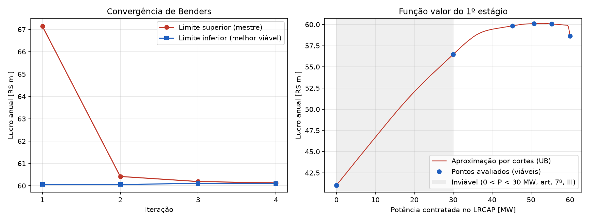
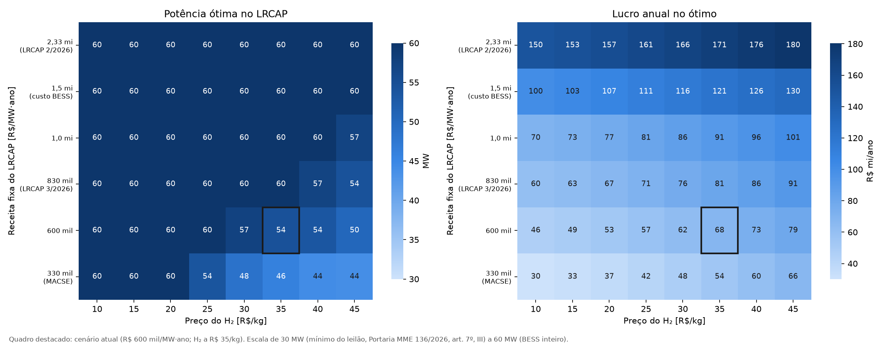
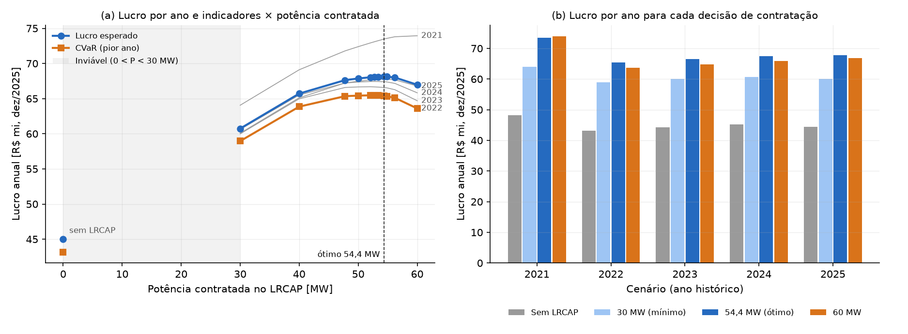
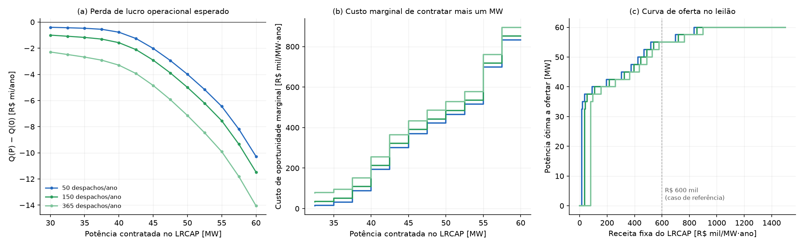
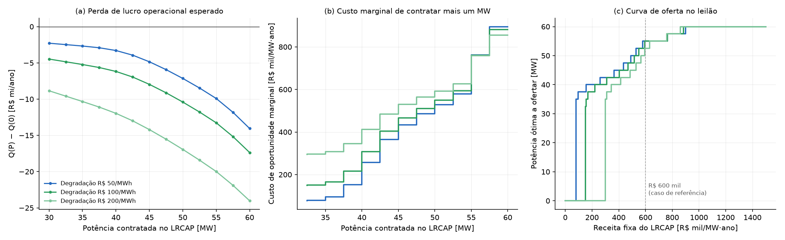
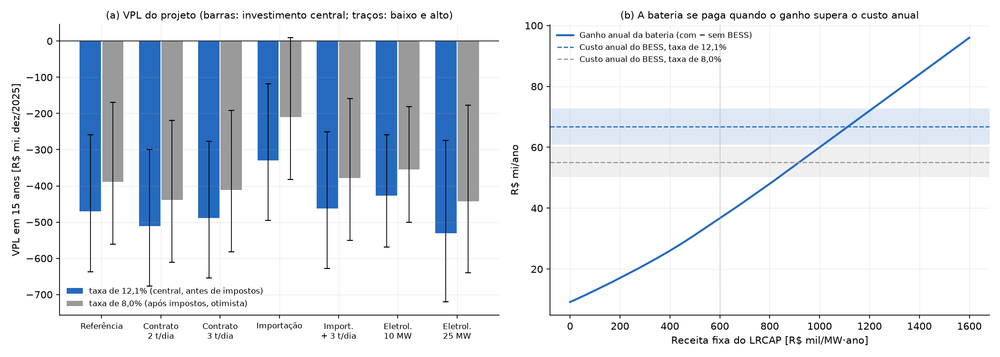
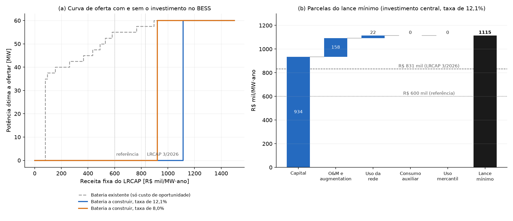

# Lance mínimo e custo de oportunidade de baterias no Leilão de Reserva de Capacidade

**O papel da produção de hidrogênio verde em sistemas híbridos fotovoltaicos**

Pergunta de pesquisa: qual a menor receita fixa que viabiliza a construção de um BESS para o
LRCAP em um sistema híbrido PV-H₂, e como a produção de hidrogênio altera a quantidade a contratar
quando a bateria já existe?

Repositório do modelo de otimização da dissertação de mestrado. O modelo é um MILP
implementado em Python/[Pyomo](https://www.pyomo.org/) e resolvido com o
[HiGHS](https://highs.dev/) (gratuito e de código aberto).

```
 Lado mercantil (operado pelo empreendedor)
   PV ────────────┐
   BESS mercantil ◄┼─► Eletrolisador ─► Tanque H₂ ─► venda de H₂
                   └─► exportação ao MCP (PLD) ──┐
                                                 ├─► ponto de conexão compartilhado ◄─► SIN
 BESS módulo LRCAP ◄─► despacho do ONS ──────────┘   (receita fixa; energia liquidada na CONCAP)
```

As regras do LRCAP seguem a **Portaria Normativa MME nº 136/2026** (LRCAP de 2026 —
Armazenamento). O ponto central: a potência contratada é operada pelo ONS e não pode
gerar receita no MCP (art. 9º §5º, IV e §6º). Por isso a arbitragem é modelada como a
**divisão do BESS** entre um módulo LRCAP e um módulo mercantil. Detalhes em
`docs/formulacao.md`.

## Estrutura

```
config/caso_base.yaml      parâmetros do caso (valores PLACEHOLDER — substituir por dados reais)
config/itajuba_2025.yaml   mesmo caso com PLD SE/CO e PV de Itajubá (requer data/ gerado pelo importador)
config/economia.yaml       custos de investimento, O&M fixo e taxas de desconto (viabilidade)
config/unifei_escalonada.yaml  planta da UNIFEI (1 MWp + PEM 350 kW) escalonada a 50 MWp + 17,5 MW
docs/formulacao.md         formulação matemática completa (conjuntos, parâmetros, variáveis, restrições)
src/pvbess_h2/
  parametros.py            leitura/validação do YAML
  dados.py                 séries de entrada (PV, PLD, despacho do ONS) — reais via CSV ou sintéticas
  modelo.py                construção do modelo Pyomo e chamada do solver
  resultados.py            série horária de resultados, indicadores e gráfico
  importacao.py            leitura dos formatos da CCEE e do PVGIS
  decomposicao.py          Benders com cortes reforçados (P_cap no mestre, semanas nos subproblemas)
scripts/
  rodar_caso.py            resolve um caso e salva CSV + indicadores + gráfico em resultados/
  varredura_lrcap.py       sensibilidade: lucro × potência contratada no LRCAP
  importar_dados.py        converte CSVs brutos da CCEE (PLD) e do PVGIS (PV) para data/
  importar_emissoes.py     fator de emissão horário do SIN a partir da geração por usina do ONS
  anual_benders.py         ano completo por decomposição de Benders (blocos semanais em paralelo)
  estocastico.py           programa estocástico com CVaR (anos históricos como cenários)
  vss_evpi.py              VSS e EVPI do programa estocástico
  curva_oferta.py          curva de oferta no LRCAP (contrato de H₂, importação, despacho, degradação, dimensionamento)
  erro_decomposicao.py     efeito do tamanho do bloco da decomposição (7, 14, 28 dias)
  viabilidade.py           VPL, TIR, lance mínimo (parcelas e sensibilidade) e H₂ de equilíbrio (config/economia.yaml)
tests/                     testes (modelo, importação de dados, decomposição)
```

## Como rodar

```bash
pip install -r requirements.txt
python scripts/rodar_caso.py                     # caso base (7 dias)
python scripts/varredura_lrcap.py --passos 11    # curva de arbitragem LRCAP x MCP
python scripts/anual_benders.py                  # ano completo de Itajubá (≈ 75 s em 4 núcleos)
python -m pytest                                 # testes
```

Para criar um novo cenário, copie `config/caso_base.yaml` (ex.: `config/cenario_h2_barato.yaml`),
altere os parâmetros e rode `python scripts/rodar_caso.py config/cenario_h2_barato.yaml`.
Os resultados vão para `resultados/<nome_do_cenario>/`.

### Usando dados reais — caso Itajubá (MG), submercado SE/CO

1. **PLD horário** — [dados abertos da CCEE](https://dadosabertos.ccee.org.br), conjunto
   "PLD horário": baixe o CSV do ano (ex.: 2025).
2. **Geração PV** — [PVGIS](https://re.jrc.ec.europa.eu/pvg_tools/pt/), aba *Dados horários*:
   lat. `-22.4256`, long. `-45.4528`, marque *Potência FV* com 1 kWp, perdas 14%,
   inclinação/azimute otimizados, último ano disponível; baixe em CSV.
3. Converta para o formato do modelo (o PV é reposicionado no ano do PLD e passado para UTC-3):

   ```bash
   python scripts/importar_dados.py --pld pld_horario_2025.csv --submercado SE \
       --pv Timeseries_-22.426_-45.453_*.csv --ano 2025
   python scripts/rodar_caso.py config/itajuba_2025.yaml
   ```

**Frequência do despacho do ONS.** Por padrão o módulo LRCAP é despachado todos os dias. Com
`lrcap.despacho_ons.ciclos_ano: N`, só os N dias de cada ano civil com maior PLD no período de
descarga são despachados (sistema mais apertado); nos demais, o módulo fica cheio e não recarrega.

Formatos aceitos diretamente pelo modelo (para outras fontes):
`timestamp,pld`, `timestamp,fator_capacidade`, `timestamp,fator_kg_mwh` (fator de emissão da
rede, em `rede.fator_emissao_arquivo`) e, para o despacho do ONS,
`timestamp,descarga_pu,recarga_pu` (em `lrcap.despacho_ons.arquivo`).

## Resultados — Itajubá (MG), ano de 2025

PLD horário SE/CO de 2025 (CCEE), PV do PVGIS-ERA5 (50 MWp, fator de capacidade 16,9%),
BESS de 60 MW / 300 MWh, eletrolisador de 10 MW, despacho diário do ONS (descarga
18h–21h, recarga 10h–14h). **Parâmetros econômicos ainda provisórios** (receita fixa de
R\$ 600 mil/MW·ano; H₂ a R\$ 35/kg).

Ótimo anual por Benders (3 iterações, *gap* 0,04%): **P_cap = 50,8 MW**, lucro de
**R\$ 60,1 mi/ano**.



| Potência no LRCAP | Lucro anual | MCP | H₂ | Receita fixa |
|---|---|---|---|---|
| 0 MW | R\$ 41,0 mi | 0,9 | 43,8 | 0 |
| 30 MW (mínimo) | R\$ 56,5 mi | 0,7 | 43,6 | 18,0 |
| **50,8 MW (ótimo)** | **R\$ 60,1 mi** | 3,8 | 31,7 | 30,5 |
| 60 MW (BESS inteiro) | R\$ 58,6 mi | 6,5 | 21,5 | 36,0 |

- Participar do LRCAP aumenta o lucro em cerca de R\$ 19 mi/ano em relação a não participar.
- O ótimo é **plano** entre 45 e 55 MW (variação < 0,5%): a escolha exata depende mais dos
  parâmetros econômicos provisórios do que da operação.
- Semanas isoladas levam a ótimos de 35 a 56 MW. Por isso a decisão, que vale por 15 anos
  de contrato, precisa ser tomada sobre o ano inteiro.
- A troca central é **H₂ × receita fixa**: cada MW contratado tira bateria que alimentaria
  o eletrolisador à noite (fator de capacidade do eletrolisador: 0,57 no ótimo).

### Planta da UNIFEI escalonada

Proporção eletrolisador/FV da planta real (PEM NEA|Hytron de 350 kW para ~1 MWp = 0,35),
escalonada para 50 MWp e **17,5 MW** de eletrolisador (carga mínima de 10%, típica de PEM).
O BESS continua hipotético (a planta não tem bateria).

| Caso | Eletrolisador | P_cap ótimo | Lucro anual | H₂ produzido | FC do eletrolisador |
|---|---|---|---|---|---|
| `itajuba_2025` | 10 MW | 50,8 MW | R\$ 60,1 mi | 905 t | 0,57 |
| `unifei_escalonada` | 17,5 MW | **54,4 MW** | R\$ 67,5 mi | 1.117 t | 0,40 |

Com um eletrolisador maior, mais PV é convertido em H₂ **durante o dia**, sem passar pela
bateria. O módulo mercantil perde valor e o ótimo desloca mais potência para o LRCAP.
Pendências: catálogo do eletrolisador e geração medida da UFV.

### Sensibilidade: receita fixa do LRCAP × preço do H₂

Benders anual em 48 combinações (6 receitas fixas × 8 preços de H₂), caso `unifei_escalonada`
(`python scripts/mapa_sensibilidade.py`, ~56 min em 4 núcleos; *gap* máximo 0,11%).



Referências para a faixa de receita fixa (não há leilão anterior de baterias no Brasil):

| Receita fixa | Referência | Observação |
|---|---|---|
| R\$ 330 mil/MW·ano | 1º leilão MACSE (Itália, Terna, 30/09/2025): € 12.959/MWh·ano, baterias de lítio, 15 anos | Convertido para 4 h com PTAX de 30/09/2025 (R\$ 6,2396/€) = R\$ 323 mil |
| R\$ 830 mil/MW·ano | Leilão nº 3/2026-ANEEL (LRCAP, 20/03/2026): 501,3 MW de térmicas existentes a óleo e biodiesel, R\$ 831.251,52/MW·ano, deságio 50,1% | Piso: usinas existentes, sem investimento |
| R\$ 1,0 e 1,5 mi/MW·ano | CAPEX de referência de BESS da EPE (Caderno de Parâmetros de Custos, PDE 2035): R\$ 5.000–6.000/kW | Anualizado a 12,1% a.a. (taxa central) em 15 anos = R\$ 738–886 mil/MW·ano só de capital; os valores somam O&M, encargos e reposição (estimativa própria) |
| R\$ 2,33 mi/MW·ano | Leilão nº 2/2026-ANEEL (LRCAP, 18/03/2026): 18,97 GW de térmicas a gás, biometano e carvão e ampliações hidrelétricas, novas e existentes, R\$ 2,334 mi/MW·ano, deságio 5,5% | Teto: expansão térmica e hidrelétrica |

Fontes: boletins InfoLeilão Expresso da CCEE (04º e 05º LRCAP 2026), comunicado da Terna de
01/10/2025 e Caderno de Parâmetros de Custos MME/EPE (nov/2025). Detalhes e referências completas no
Quadro 4.1 de `docs/dissertacao/cap4_resultados.md`. A duração (h) associada ao CAPEX da EPE ainda
precisa ser conferida no documento original.

- Em **nenhuma** combinação compensa ficar fora do LRCAP: a potência ótima vai de 43,8 a 60 MW.
- Com receita fixa ≥ R\$ 1,5 mi/MW·ano (custo estimado de baterias), o ótimo é **toda a bateria
  no LRCAP** para qualquer preço de H₂ da faixa.
- A fronteira em que o ótimo deixa de ser 60 MW se desloca para a direita com a receita fixa:
  H₂ a R\$ 25/kg (R\$ 330 mil), R\$ 30/kg (600 mil), R\$ 40/kg (830 mil), R\$ 45/kg (1,0 mi).
- Contratar 54,4 MW (ótimo do cenário atual) custa até R\$ 11,6 mi/ano de arrependimento se a
  receita fixa vier alta; errar para cima (60 MW) tende a custar menos
  (`docs/figuras/mapa_sensibilidade_arrependimento.png`).

### Modelo estocástico: 5 anos históricos (2021–2025) como cenários

Programa de dois estágios com CVaR (`python scripts/estocastico.py`, ~15 min em 4 núcleos):
potência no LRCAP no 1º estágio; operação em cada ano de PLD SE/CO (corrigido pelo IPCA
para dez/2025) e FV PVGIS-SARAH3, com despacho do ONS ligado ao PLD. α = 0,8 (pior ano),
anos equiprováveis. Caso `estocastico_unifei` (17,5 MW de eletrolisador, receita fixa de
R\$ 600 mil/MW·ano, H₂ a R\$ 35/kg, partida a R\$ 500 — provisórios).



| Potência no LRCAP | Lucro esperado | CVaR (pior ano, 2022) |
|---|---|---|
| 0 MW | R\$ 45,0 mi | R\$ 43,2 mi |
| 30 MW | R\$ 60,7 mi | R\$ 59,0 mi |
| **54,4 MW (ótimo)** | **R\$ 68,1 mi** | **R\$ 65,4 mi** |
| 60 MW | R\$ 67,0 mi | R\$ 63,6 mi |

- Fronteira risco–retorno (tolerância de 0,01%, *gap* < 0,01%): a potência ótima recua de 54,4 MW
  (β = 0) para 53,4 MW (β = 0,5 e 1), 52,7 MW (β = 2) e 52,1 MW (β = 5). Entre os extremos, o lucro
  esperado cai R\$ 81 mil/ano e o CVaR sobe R\$ 85 mil/ano: **a troca entre risco e retorno existe,
  mas é pequena** (≈ 0,1%). Com tolerância de 0,1%, ela ficava abaixo da precisão e a fronteira
  parecia degenerar em 53,4 MW.
- O pior ano é 2022 (PLD no piso o ano todo) e o melhor, 2021 (crise hídrica); a diferença
  entre eles é de cerca de R\$ 8 mi/ano, pequena perto do ganho de contratar no LRCAP.
- O ótimo estocástico (54,4 MW) coincide com o determinístico de 2025 (54,4 MW).

#### VSS e EVPI (β = 0)

`python scripts/vss_evpi.py` (~45 min em 4 núcleos; tolerância de Benders 0,01%). O ano médio
é a média hora a hora dos 5 anos (PLD corrigido pelo IPCA).

| Decisão | P_cap | 2021 | 2022 | 2023 | 2024 | 2025 | Esperado |
|---|---|---|---|---|---|---|---|
| RP (estocástico) | 54,38 MW | 73,47 | 65,38 | 66,58 | 67,40 | 67,77 | **68,121** |
| EV (ano médio) | 54,34 MW | 73,46 | 65,39 | 66,58 | 67,40 | 67,77 | **68,121** (EEV) |
| WS (ótimo de cada ano) | 60 / 51,5 / 51,0 / 52,7 / 54,6 | 73,95 | 65,47 | 66,70 | 67,44 | 67,77 | **68,266** |

(R\$ mi/ano, dez/2025.)

- **VSS = RP − EEV ≈ R\$ 300/ano** (< 0,001%, abaixo da tolerância): a decisão do ano médio
  é praticamente a mesma do modelo estocástico. Com a tolerância mais apertada, o ótimo
  estocástico passou de 53,4 para 54,4 MW, com diferença de lucro de só R\$ 20 mil/ano:
  a curva é plana perto do ótimo.
- **EVPI = WS − RP ≈ R\$ 145 mil/ano** (0,21%; limite superior de R\$ 161 mil): saber de
  antemão o ano que vai ocorrer valeria pouco. A maior perda está em 2021 (crise hídrica),
  quando o melhor seria colocar toda a bateria no LRCAP (60 MW).
- O modelo do ano médio acerta a **decisão**, mas superestima o **lucro** (EV = R\$ 68,89 mi
  contra R\$ 68,12 mi de EEV): a média suaviza os picos e vales de PLD e de irradiação.
- Com estes cenários, a incerteza de PLD e de FV **não muda** a potência a contratar. A
  incerteza que pesa na decisão é a dos parâmetros econômicos (receita fixa e preço do H₂;
  ver mapa de sensibilidade).

### Curva de oferta no LRCAP: contrato de H₂, importação e frequência de despacho

`python scripts/curva_oferta.py` (~1h30 em 4 núcleos). Para cada caso, o lucro operacional
esperado nos 5 anos sem a receita fixa, Q(P), numa grade de 2,5 MW; o custo de oportunidade de
contratar mais um MW é −dQ/dP e a potência ótima para cada receita fixa R é argmax R·P + Q(P).
Contrato de H₂: volume diário firme (mínimo = máximo), multa de R\$ 35/kg não entregue
(provisória). A multa é uma cláusula de firmeza, não ressarcimento do produto (este seria só a
diferença entre o preço de reposição e o do contrato); somada à venda perdida, cada kg não
entregue custa R\$ 70, e o contrato é praticamente firme.


| Caso | Ótimo (R\$ 600 mil/MW·ano) | Lucro esperado | Receita mínima para entrar | Custo do último MW |
|---|---|---|---|---|
| H₂ ilimitado, sem importação | 55 MW | R\$ 68,1 mi | R\$ 76 mil/MW·ano | R\$ 895 mil |
| Contrato 2 t/dia | 60 MW | R\$ 61,8 mi | R\$ 84 mil | R\$ 172 mil |
| Contrato 3 t/dia | 55 MW | R\$ 65,5 mi | R\$ 95 mil | ~R\$ 2,0 mi |
| H₂ ilimitado, com importação | 60 MW | R\$ 88,5 mi | R\$ 96 mil | R\$ 474 mil |
| Contrato 3 t/dia, com importação | 60 MW | R\$ 68,9 mi | R\$ 86 mil | R\$ 406 mil |

- Os primeiros 35–40 MW custam R\$ 80–100 mil/MW·ano em todos os casos: participar é robusto;
  o que depende das hipóteses são os últimos 15–20 MW.
- Contrato de 2 t/dia: o H₂ excedente não tem comprador, a exportação ao MCP dobra (19 → 37 GWh)
  e a bateria vale pouco fora do LRCAP. Com 3 t/dia, a bateria garante a entrega noturna
  (ainda há déficit de ~4%, 40 t/ano) e os últimos MW ficam caros.
- Importar da rede (fim do "H₂ verde estrito") leva o eletrolisador a FC 0,92 e o lucro a
  +R\$ 20 mi/ano; a bateria deixa de ser necessária ao H₂. É a hipótese que mais pesa.
- A troca LRCAP × MCP do título só aparece com demanda de H₂ limitada; sem limite, a troca é
  LRCAP × H₂.

**Frequência do despacho do ONS** (`lrcap.despacho_ons.ciclos_ano`; casos `ciclos_50`,
`ciclos_150`, `ciclos_365`, H₂ ilimitado):



| Despachos/ano | Ótimo | Lucro esperado | Receita mínima para entrar |
|---|---|---|---|
| 50 | 55 MW | R\$ 71,6 mi | R\$ 13 mil/MW·ano |
| 150 | 55 MW | R\$ 70,5 mi | R\$ 33 mil |
| 365 | 55 MW | R\$ 68,1 mi | R\$ 76 mil |

- A frequência só desloca a curva de custo marginal em paralelo, exatamente pelo custo de
  degradação do módulo LRCAP: c_deg × 4 h × (365 − N) = R\$ 63 mil/MW·ano entre 50 e 365.
  A operação mercantil (MCP, H₂) é idêntica nos três casos, e o ótimo não muda.
- Esse custo pode ser calculado à parte, sem simulação; a frequência importa para o limiar de
  entrada, não para a potência ótima.

### Limite de emissões do H₂ (alternativa ao H₂ verde estrito)

Em vez de proibir a compra da rede, `hidrogenio.limite_emissoes_kg_kg` limita a intensidade de
emissões do H₂ em cada semana (Lei 14.948/2024: 7 kgCO₂eq/kgH₂ até 2030). A energia da rede só
pode ir ao eletrolisador e é toda atribuída ao H₂:

    p_imp[t] ≤ p_el[t]
    Σ_semana [ f_t · p_imp[t] + f_pv · (p_el[t] − p_imp[t]) ] + e_proc · H  ≤  L · H

Com 55 kWh/kg, isso equivale a um fator médio de até 127 kgCO₂/MWh na energia do eletrolisador
(L = 7) ou 62 kg/MWh (L = 3,4, próximo do critério da UE). L = 0 reproduz o H₂ verde estrito. A
restrição é linear e fica dentro de cada bloco semanal da decomposição.

**Fator de emissão da rede** (`python scripts/importar_emissoes.py`): para cada hora de 2021–2025,
soma das térmicas fósseis (geração por usina do ONS × fator do IPCC por combustível, com
rendimento típico: gás 449, carvão 988, óleo 700–730 kg/MWh) dividida pela geração do SIN sem
MMGD. Médias anuais: 94 (2021), 31, 27, 37 e 42 kg/MWh (2025). Em jan–abr/2025 a média mensal
fica 2% a 5% abaixo da do MCTI (metodologia de 2025); pela metodologia anterior, os fatores do MCTI
de 2021–2023 são 34% a 42% maiores. Sensibilidade marginal: toda compra vem de térmica a gás
(449 kg/MWh). Emissões só de operação; a FV entra com zero (com ciclo de vida, 48 kg/MWh,
`pv.fator_emissao_kg_mwh`, ela sozinha daria 2,6 kgCO₂/kgH₂).


| Caso | Ótimo (R\$ 600 mil) | Lucro esperado | FC do eletrolisador | H₂ | Compra da rede | Intensidade | Receita para 60 MW | H₂ de equilíbrio (12,1%) |
|---|---|---|---|---|---|---|---|---|
| H₂ verde estrito | 55 MW | R\$ 68,1 mi | 0,37 | 1.029 t | 0 | 0 | R\$ 895 mil | R\$ 103/kg |
| Limite 3,4, fator marginal | 52,5 MW | R\$ 70,5 mi | 0,45 | 1.251 t | 9 GWh | 3,38 kg/kg | R\$ 914 mil | R\$ 89/kg |
| Limite 7, fator marginal | 50 MW | R\$ 73,8 mi | 0,56 | 1.567 t | 24 GWh | 6,93 kg/kg | R\$ 1,007 mi | R\$ 76/kg |
| Limite 3,4, fator médio | 60 MW | R\$ 88,3 mi | 0,91 | 2.524 t | 90 GWh | 1,40 kg/kg | R\$ 496 mil | R\$ 54/kg |
| Limite 7, fator médio | 60 MW | R\$ 88,5 mi | 0,92 | 2.553 t | 92 GWh | 1,47 kg/kg | R\$ 474 mil | R\$ 54/kg |
| Importação livre | 60 MW | R\$ 88,5 mi | 0,92 | 2.553 t | 92 GWh | – | R\$ 474 mil | R\$ 54/kg |

- **Com o fator médio do SIN, nenhum dos limites restringe**: mesmo comprando 92 GWh, o H₂ fica em
  1,5 kgCO₂/kg, e o resultado é igual ao da importação livre. O que corta 1.500 t/ano de H₂ é a
  regra de H₂ verde estrito, não o limite da lei.
- **Com o fator marginal, os limites restringem** (intensidade no teto): a rede supre no máximo 28%
  (L = 7) ou 14% (L = 3,4) da energia do eletrolisador.
- **A bateria muda de papel.** Com o fator médio, a rede substitui a bateria à noite e os últimos MW
  ficam baratos (R\$ 474 mil). Com o fator marginal, cada MWh solar guardado "abre espaço" para
  comprar mais da rede: a bateria vale mais fora do leilão, e o ótimo cai para 50 MW.
- **O lance mínimo da bateria a construir não muda** (R\$ 1,157 mi com o BESS de referência,
  R\$ 1,104 mi dimensionado para o contrato): a regra de emissões altera a economia do H₂, não a
  da bateria contratada.
- O VPL do híbrido melhora (−R\$ 489 mi → −R\$ 457 mi com L = 7 marginal → −R\$ 362 mi com o fator
  médio), mas continua negativo. Nos casos marginais, o H₂ de equilíbrio usa o volume na potência
  ótima da curva (50 e 52,5 MW), e o VPL, 55 MW: o preço está levemente subestimado.
- As curvas "estrito" e "importação livre" são anteriores à fronteira LP (diferença de ~0,04%).

### Robustez: degradação, dimensionamento e decomposição

**Custo de degradação do BESS existente.** R\$ 50/MWh é o custo marginal do desgaste. O custo
integral de reposição ÷ energia descarregada na vida útil — pack de US\$ 70/kWh (BNEF, 2025) ×
R\$ 5,40/US\$ × 1,74 (tributos, EPE) ÷ (4.000–6.000 ciclos × 90% de DoD) ≈ R\$ 120–185/MWh — é um
limite superior. Na decisão de construir o BESS, o desgaste contratado vai para o O&M (ver
Viabilidade), para não pagar a bateria duas vezes.



| Degradação | Ótimo (R\$ 600 mil) | Lucro esperado | Receita mínima para entrar | Custo do último MW |
|---|---|---|---|---|
| R\$ 50/MWh | 55 MW | R\$ 68,1 mi | R\$ 76 mil/MW·ano | R\$ 895 mil |
| R\$ 100/MWh | 55 MW | R\$ 63,7 mi | R\$ 149 mil | R\$ 881 mil |
| R\$ 200/MWh | 52,5 MW | R\$ 54,9 mi | R\$ 295 mil | R\$ 854 mil |

- A potência ótima quase não muda (55 → 52,5 MW com 4× a degradação): o custo maior também
  encarece o uso mercantil da bateria, e os dois efeitos se compensam no alto da curva.
- O que muda é o limiar de entrada (R\$ 76 → 295 mil) e o lucro (−R\$ 13 mi/ano).

**Tamanho do eletrolisador** (H₂ ilimitado; referência 17,5 MW):


| Eletrolisador | Ótimo (R\$ 600 mil) | Lucro esperado | FC do eletrolisador | Custo marginal até 45 MW |
|---|---|---|---|---|
| 10 MW | 50 MW | R\$ 60,4 mi | 0,53 | R\$ 330–550 mil |
| 17,5 MW | 55 MW | R\$ 68,1 mi | 0,37 | R\$ 80–370 mil |
| 25 MW | 57,5 MW | R\$ 73,5 mi | 0,30 | R\$ 76–80 mil |

- Com eletrolisador maior, mais FV vira H₂ de dia e a bateria mercantil vale menos: o custo
  de contratar fica plano (~R\$ 77 mil/MW·ano) até 45 MW. Com 10 MW, a bateria é necessária
  desde o mínimo de 30 MW. A relação eletrolisador/FV (0,35, herdada da UNIFEI) molda a curva.

**Tanque de H₂ no contrato de 3 t/dia** (2 t → 10 t, com 55 MW no LRCAP): déficit de 40 → 11 t/ano,
lucro +R\$ 1,6 mi/ano, custo marginal entre 30 e 50 MW de R\$ 100–169 mil → R\$ 85–126 mil e lance
mínimo de R\$ 1,078 → 1,056 mi/MW·ano (12,1%). O tanque guarda o H₂ dos dias de sol para os nublados, papel
que, com 2 t, cabia à bateria mercantil. Com 60 MW (sem bateria mercantil) os dois tanques dão o
mesmo resultado: o eletrolisador só opera de dia e quase não sobra H₂ para guardar.

**Erro da decomposição semanal** (`python scripts/erro_decomposicao.py`, caso 2025, P_cap fixo
em 54,44 MW): lucro idêntico com blocos de 7, 14 e 28 dias (diferença < 10⁻¹¹). Benders com
blocos de 14 dias: 55,5 MW e R\$ 67,53 mi (contra 54,4 MW e R\$ 67,51 mi com 7 dias), diferença
de 0,03%, dentro da região plana do ótimo. Sem contrato de H₂, a condição cíclica semanal não
restringe a operação.

**Com contrato de H₂, a condição cíclica semanal restringe**: cada semana começava com o BESS
mercantil em 50% e o tanque vazio, o que impede guardar energia e H₂ de uma semana para outra.
No contrato de 3 t/dia, o lucro ficava 2,3–3,8% abaixo (9% com tanque de 10 t). Correção
(`estocastico.fronteira_blocos: lp`, padrão no `estocastico_unifei.yaml`): nas avaliações com
P_cap fixo, resolve-se a relaxação linear do ano inteiro (limite superior, < 1 min) e os estados
de SOC e de estoque de H₂ dela, no início e no fim de cada semana, viram a fronteira dos blocos
MILP (limite inferior). Diferença entre os limites < 0,1% até 55 MW, até 0,33% em 57,5 MW e até
1,6% em 60 MW nos casos com contrato; sem contrato, os dois tratamentos diferem em 0,01%. O
Benders mantém a condição cíclica (os cortes exigem fronteira fixa). O perfil do ONS no módulo
LRCAP é calculado no ano inteiro e recortado por bloco (antes, cada bloco começava com o módulo
cheio e faltavam 52 recargas por ano, sem efeito no lucro porque κ = 0).

### Viabilidade econômica e lance mínimo

`python scripts/viabilidade.py` (usa os resultados da curva de oferta; `--sem-bess` refaz o caso
sem bateria, ~1 min). Parâmetros em `config/economia.yaml`:

| Parâmetro | Valores (baixo; central; alto) | Fonte |
|---|---|---|
| CAPEX FV | R\$ 3.000–5.500/kW | EPE/MME, Caderno de Parâmetros de Custos – PDE 2035 |
| CAPEX BESS | R\$ 5.000–6.000/kW de um sistema de **4 h** (sensibilidade 3 h), com 45%; **60%**; 75% proporcionais à energia | EPE PDE 2035 (duração não informada; edições anteriores usavam 3 h); composição típica de sistemas de 4 h (BESS-Market 2026, Ember 2025) |
| CAPEX eletrolisador | US\$ 1.100–2.500/kW (PTAX R\$ 5,4025) | IEA, Global Hydrogen Review 2025 |
| O&M fixo | 2,5% (BESS, inclui reposição de módulos), 1,5% (FV), 3% (eletrolisador) | BESS: NREL ATB 2024; demais: hipótese |
| Taxa real | **12,1% (antes de impostos, central)**; 8,0% (após impostos, sensibilidade) | ANEEL 2026 (WACC da geração) |
| TUST de geração | R\$ 5,68; 10,93; 19,49/kW·mês sobre o MUST de injeção **compartilhado**, max(FV, BESS) | ANEEL ciclo 2026/27 (média nacional e faixa regional) |
| Sensibilidades de rede | MUST somado (FV + BESS); cobrança dupla (TUST de consumo de R\$ 15,23/kW·mês) | REN ANEEL 1.162/2026 (a confirmar) |
| Consumo auxiliar do BESS | 0; 1%; 2% da potência | indicativo de fornecedor, a confirmar |
| Disponibilidade | 100% (sensibilidade 97%) | Portaria MME 136/2026 |
| Horizonte | 15 anos, sem valor residual | prazo do contrato |

Quatro escolhas tornam a análise coerente:
- **Sem dupla contagem da degradação.** O investimento é amortizado em 15 anos sem valor residual
  e o O&M de 2,5% já inclui a reposição parcial de módulos (*augmentation*) para ~1 ciclo/dia. Na
  decisão de construir, o desgaste do módulo LRCAP não é cobrado por MWh (R\$ 73 mil/MW·ano
  devolvidos a Q(P)); o uso mercantil mantém R\$ 50/MWh. A curva Q(P) do BESS existente não muda.
- **Taxa coerente com o fluxo.** O fluxo é antes de impostos, então a taxa central é a antes de
  impostos (12,1%); 8% ignora o IR e é otimista.
- **Custo da bateria por potência e energia:** C = c_ref [(1 − f) P + f E / h_ref]. A bateria do modelo
  tem 5 h (300 MWh / 60 MW), então custa R\$ 380 mi, 15% acima de um sistema de 4 h (R\$ 330 mi).
- **Uso da rede da usina híbrida.** A bateria divide a conexão com a FV (MUST = max(50, 60) = 60 MW,
  com a FV limitada quando a bateria injeta) e só acrescenta 10 MW de TUST. As curvas foram obtidas
  com conexão de 80 MW; com 60 MW, a diferença a partir de 50 MW contratados é a FV nas horas de
  descarga do ONS (~R\$ 1 mil/MW·ano). Consumo auxiliar e disponibilidade completam os custos fixos.



| Caso (CAPEX central, R\$ 600 mil/MW·ano) | CAPEX | Lucro operacional | VPL (12,1%) | VPL (8%) | TIR real | H₂ de equilíbrio (12,1%) |
|---|---|---|---|---|---|---|
| Referência (55 MW no LRCAP) | R\$ 781 mi | R\$ 72,1 mi/ano | **−R\$ 489 mi** | −R\$ 412 mi | −2,3% | R\$ 108/kg |
| Contrato 3 t/dia | R\$ 781 mi | R\$ 69,5 mi/ano | −R\$ 506 mi | −R\$ 434 mi | −3,0% | R\$ 108/kg |
| Importação da rede | R\$ 781 mi | R\$ 92,9 mi/ano | −R\$ 362 mi | −R\$ 251 mi | 2,2% | R\$ 57/kg |
| Eletrolisador 10 MW | R\$ 700 mi | R\$ 64,2 mi/ano | −R\$ 444 mi | −R\$ 376 mi | −2,5% | R\$ 115/kg |
| Eletrolisador 25 MW | R\$ 862 mi | R\$ 77,7 mi/ano | −R\$ 550 mi | −R\$ 467 mi | −2,6% | R\$ 107/kg |

- **Nenhum caso se paga.** Fluxo do caso de referência: R\$ 72,1 mi − O&M R\$ 18,3 mi − TUST
  R\$ 7,9 mi − PIS/Cofins R\$ 2,7 mi = R\$ 43,1 mi/ano. Nem a importação com CAPEX baixo e taxa de 8%
  empata (−R\$ 32 mi).
- **Tributos e reajuste** (`config/economia.yaml`): PIS/Cofins de 3,65% (lucro presumido) sobre a receita
  bruta, 9,25% como sensibilidade; receita fixa reajustada pelo IPCA (a confirmar no edital), sem reajuste
  como sensibilidade.
- **Usina FV + eletrolisador sem BESS:** investimento de R\$ 402 mi, fluxo de R\$ 18,6 mi/ano, VPL de
  −R\$ 276 mi (12,1%) (`usina_sem_bess.csv`). A conexão que o BESS compartilha só existe se essa usina for
  construída por outras razões.
- **Valor da bateria:** lucro sem BESS = R\$ 35,4 mi/ano; com BESS e 55 MW a R\$ 600 mil,
  R\$ 72,1 mi. O ganho de R\$ 35,5 mi/ano, após PIS/Cofins, não cobre o custo anual do BESS (R\$ 66,8 mi a 12,1%:
  capital 56,0 + O&M 9,5 + TUST 1,3). Sem o LRCAP, a bateria agrega só R\$ 8,8 mi/ano.

**Curva de oferta com o investimento no BESS e lance mínimo.** Se a bateria ainda vai ser
construída, para cada receita fixa R o proponente compara não construí-la (lucro sem BESS) com
construí-la e contratar a melhor potência: max_P {R·k·P + Q_inv(P)} − custo anual do BESS, com k = disponibilidade × (1 − PIS/Cofins) × perda real sem reajuste.



| Taxa | CAPEX de referência baixo (R\$ 5.000/kW) | central (R\$ 5.500/kW) | alto (R\$ 6.000/kW) |
|---|---|---|---|
| 12,1% (central) | R\$ 1,054 mi | **R\$ 1,157 mi** | R\$ 1,260 mi |
| 8,0% | R\$ 870 mil | R\$ 954 mil | R\$ 1,039 mi |

- Com o BESS de referência (60 MW/300 MWh), a oferta é "tudo ou nada": zero abaixo do lance
  mínimo e 60 MW acima dele (ver o dimensionamento abaixo).
- **O lance mínimo é o custo anual do BESS por MW mais o PIS/Cofins:** capital R\$ 934 mil + O&M com
  augmentation R\$ 158 mil + acréscimo de TUST R\$ 22 mil + PIS/Cofins R\$ 43 mil = R\$ 1,157 mi. Consumo auxiliar (cabe na folga da
  CONCAP) e uso mercantil (a 60 MW o módulo mercantil some) valem zero.
- Sensibilidade (uma premissa por vez, `lance_sensibilidade.csv`): referência da EPE de 3 h +21%;
  taxa de 8% −18%; cobrança dupla de TUST +16%; conexão não compartilhada +10%; CAPEX de referência
  ±9%; O&M ±1 p.p. ±6%; parcela de energia 45–75% ±3%; disponibilidade de 97% +3%; TUST regional
  −1% a +2%; consumo auxiliar de 2% +1%. Degradação por MWh: 0%. 50 despachos/ano: +1%.
  Contrato firme de 3 t/dia: −3% (−5% com tanque de 10 t). Sem PIS/Cofins −4%; PIS/Cofins não
  cumulativo +6%; receita fixa sem reajuste pelo IPCA (4% a.a.) +25%.
- **Papel do híbrido no lance:** dividir a conexão com a FV poupa R\$ 113 mil/MW·ano
  (R\$ 136 mil com o BESS dimensionado para o contrato), desde que a usina FV exista.
- O lance central supera em 39% os R\$ 831 mil das térmicas existentes no LRCAP 3/2026 (mesmo o
  cenário mais barato, R\$ 870 mil, fica acima) e é muito menor que os R\$ 2,33 mi do LRCAP 2/2026.

**Dimensionamento do BESS e bateria isolada** (`lance_dimensionamento.csv`). Com potência igual à
contratada e 4,8 MWh/MW, o BESS não tem módulo mercantil e não altera a operação da FV e do
eletrolisador: o lucro operacional esperado mais a degradação do LRCAP é igual ao lucro sem BESS
(verificado com o modelo para 30 e 50 MW). O lance é então o custo anual por MW:

| Arranjo | Potência (MW) | Energia (MWh) | 12,1% | 8,0% |
|---|---|---|---|---|
| Híbrido, BESS de referência | 60 | 300 | R\$ 1,157 mi | R\$ 954 mil |
| Híbrido, dimensionado para o contrato | 60 | 288 | R\$ 1,127 mi | R\$ 929 mil |
| Híbrido, dimensionado para o contrato | 30 a 50 | 4,8/MW | **R\$ 1,104 mi** | R\$ 907 mil |
| Bateria isolada (sem FV), dimensionada | 30 a 60 | 4,8/MW | R\$ 1,240 mi | R\$ 1,043 mi |

- **A bateria do leilão deve ser dimensionada para o contrato:** no BESS de referência, ofertar
  57,5 MW e manter 2,5 MW/24 MWh mercantis rende R\$ 2,1 mi/ano, mas essa capacidade custa
  R\$ 4,7 mi/ano; os 12 MWh além dos 288 MWh necessários custam R\$ 30 mil/MW·ano no lance.
- **A oferta deixa de ser "tudo ou nada":** até 50 MW a bateria cabe no MUST da usina FV e o lance
  por MW é constante (R\$ 1,104 mi); acima disso cada MW paga TUST e o lance sobe até R\$ 1,127 mi.
- **Bateria isolada:** R\$ 136 mil/MW·ano acima do híbrido, inteiramente pela TUST sobre toda a
  potência (com PIS/Cofins). No lance, o papel da FV com H₂ é dividir a conexão, não gerar receita para a bateria.

## Próximos passos sugeridos

1. Quando o edital da ANEEL sair: incluir penalidades e abatimento da receita fixa por
   indisponibilidade, e o preço inicial do leilão.
2. Definir parâmetros técnico-econômicos com base na literatura (eletrolisador PEM/alcalino, BESS Li-ion).
3. Modelo estocástico: avaliar fora da amostra e repetir o mapa
   receita fixa × preço do H₂ com os 5 cenários.
4. Eletrolisador: custo de partida, tempos mínimos ligado/desligado e *standby*.
