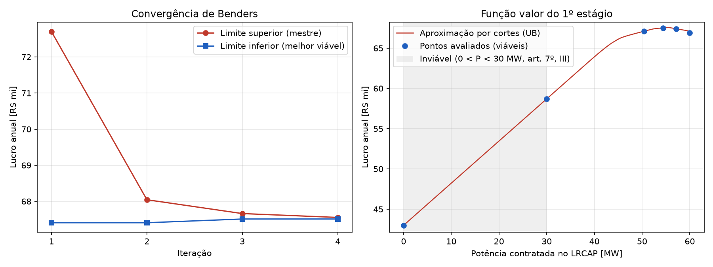
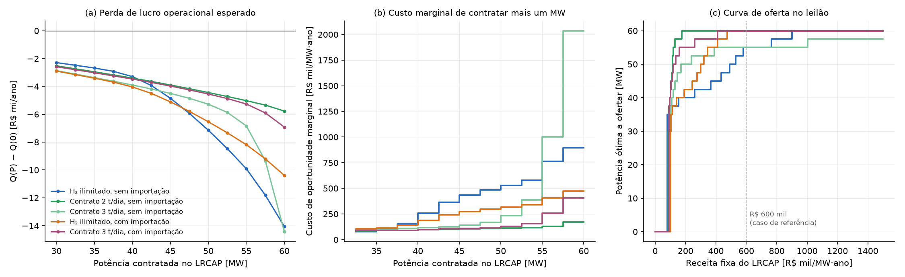
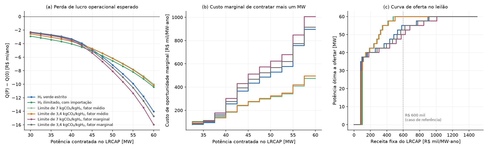
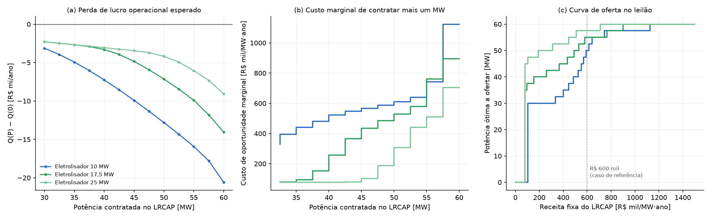
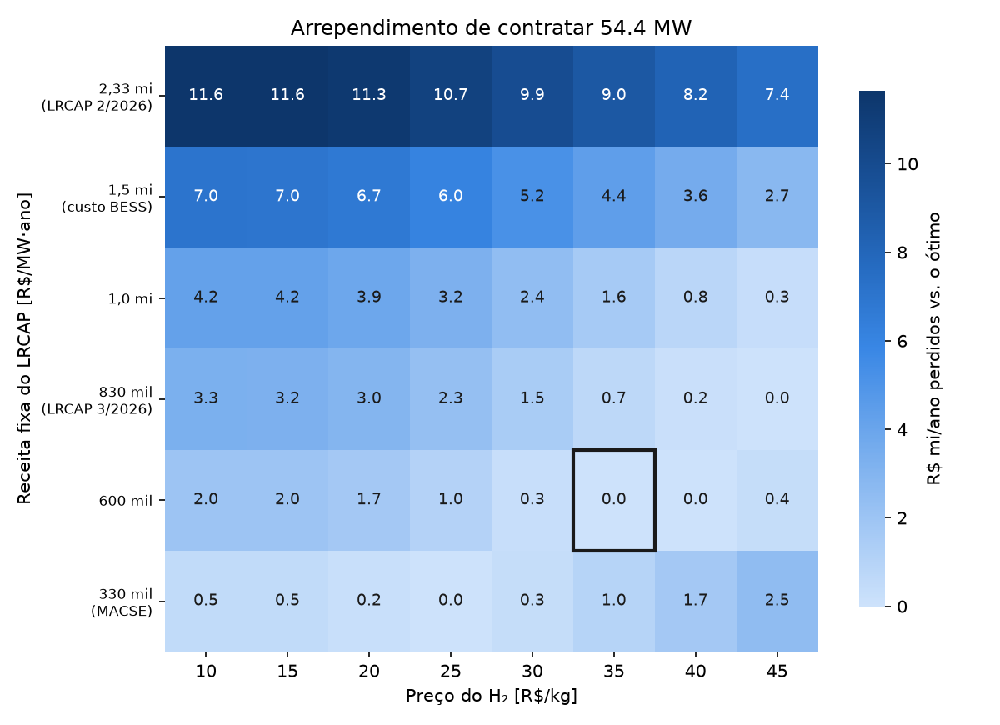

# 4 RESULTADOS E DISCUSSÃO

Este capítulo apresenta os resultados do modelo descrito no Capítulo 3, aplicado ao caso de referência: a planta da UNIFEI escalonada para 50 MWp de geração FV e 17,5 MW de eletrolisador PEM, com BESS de 60 MW e 300 MWh, conectada ao submercado SE/CO. A Seção 4.1 avalia o desempenho do método de solução no caso determinístico de 2025. A Seção 4.2 apresenta o resultado principal, a decisão de um proponente que precisa construir o BESS: a viabilidade do empreendimento e o lance mínimo no leilão. A Seção 4.3 analisa a decisão de quanto contratar quando o BESS está disponível e os fatores que a determinam. A Seção 4.4 sintetiza os resultados. Salvo indicação em contrário, os resultados correspondem ao lucro esperado nos cinco cenários anuais de 2021 a 2025 (Seção 3.7.2), em valores de dezembro de 2025; a Seção 4.1 e a Subseção 4.3.8 utilizam o caso determinístico de 2025 (Seção 3.5).

Ressalta-se que parte dos parâmetros econômicos — em especial a receita fixa do LRCAP (R\$ 600 mil/(MW·ano)), o preço do hidrogênio (R\$ 35/kg), o custo de degradação do BESS (R\$ 50/MWh), a multa contratual por déficit de hidrogênio e o custo de O&M fixo da usina FV e do eletrolisador — tem caráter provisório, conforme discutido nas Seções 3.5 e 3.8.2. Por isso, a ênfase deste capítulo recai sobre as relações entre as decisões e as hipóteses, e não sobre os valores absolutos de lucro.

## 4.1 Desempenho do método de solução

O caso determinístico utiliza o PLD do submercado SE/CO de 2025, a geração FV obtida da base ERA5 e o perfil fixo de despacho do ONS descritos na Seção 3.5, com o ano dividido em 52 blocos semanais. A Figura 4.1 apresenta a convergência do algoritmo de Benders e a aproximação da função valor do primeiro estágio construída pelos cortes.

::: {custom-style="Legenda"}
Figura 4.1 – Caso determinístico de 2025: (a) limites superior e inferior ao longo das iterações de Benders; (b) aproximação da função valor pelos cortes e pontos avaliados
:::

::: {custom-style="Figura"}
{width=16cm}
:::

::: {custom-style="Fonte"}
Fonte: elaborado pelo autor.
:::

Após a avaliação dos três pontos iniciais (0, 30 e 60 MW), o limite superior parte de R\$ 72,7 milhões, e o algoritmo converge em quatro iterações, com *gap* final de 0,06%, em 67 segundos de processamento em quatro núcleos — tempo inferior ao de uma única tentativa de solução direta do MILP anual, interrompida após 15 minutos sem solução (Seção 3.6.1). A Figura 4.1(b) mostra que a função valor é crescente e aproximadamente linear até cerca de 45 MW e praticamente plana entre 50 e 60 MW, o que explica a convergência rápida: poucos cortes bastam para delimitar a região do ótimo.

O ótimo encontrado é $P^{cap} = 54{,}4$ MW, com lucro de R\$ 67,5 milhões no ano. A Tabela 4.1 compara a composição desse resultado com o ótimo do modelo estocástico, apresentado na Subseção 4.3.1.

::: {custom-style="Legenda"}
Tabela 4.1 – Comparação entre o caso determinístico de 2025 e o modelo estocástico
:::

| Indicador | Determinístico (2025) | Estocástico (2021–2025, média) |
|------------------------------------|--------------------|--------------------|
| Potência ótima no LRCAP (MW) | 54,4 | 54,4 |
| Lucro (R\$ milhões/ano) | 67,5 | 68,1 |
| Receita fixa do LRCAP (R\$ milhões/ano) | 32,7 | 32,6 |
| Receita de H₂ (R\$ milhões/ano) | 39,1 | 36,0 |
| Receita no MCP (R\$ milhões/ano) | 1,8 | 5,1 |
| Degradação do BESS (R\$ milhões/ano) | 4,4 | 4,4 |
| H₂ produzido (t/ano) | 1.117 | 1.029 |
| Fator de capacidade do eletrolisador | 0,40 | 0,37 |

::: {custom-style="Fonte"}
Fonte: elaborado pelo autor. Valores do modelo estocástico obtidos na grade de 55 MW, exceto potência, lucro e receita fixa.
:::

As duas abordagens conduzem à mesma potência ótima. A comparação da composição, porém, não isola o efeito de um único fator, pois os dois casos diferem em quatro hipóteses: os anos de preço (2025 contra 2021 a 2025), a base de irradiância (ERA5 de 2023, reposicionada no calendário de 2025, contra SARAH-3), a regra de despacho do ONS (perfil fixo contra perfil baseado no PLD) e o custo de partida do eletrolisador (nulo contra R\$ 500 por partida). Embora a série ERA5 apresente fator de capacidade FV ligeiramente inferior ao da média dos cenários SARAH-3 (16,9% contra 17,5%), o caso determinístico produz mais hidrogênio. Duas causas contribuem para isso: no modelo estocástico, os picos de PLD do cenário de 2021, que superam o valor da energia no eletrolisador, tornam a exportação ao MCP mais vantajosa em parte das horas, e o custo de partida desestimula ligamentos curtos do eletrolisador. A coincidência das potências ótimas, apesar dessas diferenças, antecipa o resultado da Subseção 4.3.2: a variação entre anos pouco altera a decisão de contratação.

**Decomposição em blocos.** Para a potência de 54,44 MW, o lucro anual do caso determinístico de 2025 foi idêntico com blocos de 7, 14 e 28 dias (diferença relativa inferior a $10^{-11}$). Refeita a decomposição com blocos de 14 dias, o algoritmo de Benders convergiu para 55,5 MW e R\$ 67,53 milhões, contra 54,4 MW e R\$ 67,51 milhões com blocos semanais — diferença de 0,03%, inferior à tolerância de convergência e situada na região plana do ótimo. Sem contrato de hidrogênio, as condições cíclicas semanais, portanto, não restringem a operação de forma mensurável, o que é coerente com a operação em ciclos diários do módulo mercantil e do tanque, cujos estados de armazenamento tendem a retornar aos mesmos valores ao fim de cada semana.

O mesmo não vale quando há contrato de fornecimento de hidrogênio. Com entrega diária firme, guardar energia e hidrogênio de dias ensolarados para dias nublados tem valor, e a condição cíclica semanal — que obriga cada semana a começar com o módulo mercantil em 50% da carga e o tanque vazio — passa a restringir a operação. No contrato de 3 t/dia, o lucro operacional esperado com blocos cíclicos ficou entre 2,3% e 3,8% abaixo do obtido com os estados de fronteira da relaxação linear do ano (Seção 3.6.2), para potências de até 55 MW, e o déficit anual de entrega com 55 MW contratados caiu de 61 t para 40 t. Com o tanque de 10 t, a diferença chegou a 9%, pois a condição cíclica esvaziava o tanque no início de cada semana. Com a fronteira da relaxação, a diferença entre os limites inferior e superior do lucro foi inferior a 0,1% em todos os pontos das curvas de oferta dos casos com contrato até 55 MW, de até 0,33% com 57,5 MW e de até 1,6% com 60 MW. Nesse último ponto, o módulo mercantil fica sem potência e a relaxação linear, que admite o eletrolisador abaixo da carga mínima, é menos justa. Nos casos sem contrato, os dois tratamentos diferem em no máximo 0,05% no lucro esperado. Por isso, as curvas de oferta e as avaliações com potência fixa deste capítulo adotam, para cada caso, potência e cenário, o maior dos dois limites inferiores — com os estados de fronteira da relaxação ou com a condição cíclica semanal —, pois ambos correspondem a operações viáveis do ano; o limite superior é o da relaxação. Nos casos sem contrato, a condição cíclica fica até 0,05% acima; nos casos com contrato, a relaxação fica de 2% a 4% acima. Nessas avaliações, a recarga do módulo LRCAP acima da custeada pela CONCAP é apurada no ano inteiro, e não por bloco: com 50 ou 150 despachos por ano, a apuração por bloco cobraria como excedente a recarga de um despacho realizado no fim de uma semana, que cai no bloco seguinte, sem a injeção correspondente, o que reduziria o lucro em R\$ 3 mil a R\$ 4 mil/(MW·ano). Com essas duas regras, a diferença entre os limites inferior e superior fica abaixo de 0,1% até 55 MW nos casos sem contrato, exceto com o eletrolisador de 25 MW (0,19%).3, 4.3.4 e 4.3.7, foram calculados com a fronteira da relaxação.

## 4.2 BESS a construir: viabilidade e lance mínimo

Esta seção apresenta o resultado principal do trabalho: a decisão de um proponente que precisa construir o BESS para participar do leilão, situação prevista na Portaria, que trata da contratação de novos sistemas de armazenamento (BRASIL, 2026). A Subseção 4.2.1 avalia a viabilidade do empreendimento com a receita fixa de referência; a Subseção 4.2.2, o valor do BESS e o lance mínimo; a Subseção 4.2.3, a sensibilidade do lance mínimo às hipóteses do modelo; e a Subseção 4.2.4, o dimensionamento do BESS e a comparação com uma bateria isolada.

### 4.2.1 Viabilidade do empreendimento

O modelo de operação maximiza o lucro operacional, sem os custos de investimento. Esta subseção avalia, segundo o procedimento da Seção 3.8.2, se o empreendimento se paga com a receita fixa de referência. Os resultados são apresentados na Tabela 4.2 e na Figura 4.2.

::: {custom-style="Legenda"}
Tabela 4.2 – Viabilidade econômica em 15 anos (receita fixa de R\$ 600 mil/(MW·ano))
:::

| Caso | Invest. (R\$ mi) | Lucro op. (R\$ mi/ano) | VPL a 12,1% (R\$ mi) | VPL a 8,0% (R\$ mi) | TIR real | H₂ eq. (R\$/kg) |
|----------------------|----------|----------|----------------------|----------|--------|-----------|
| Referência | 792 | 72,1 | −546 (−722 a −321) | −454 | −3,1% | 116 |
| Contrato 2 t/dia | 792 | 66,2 | −584 (−760 a −359) | −502 | −4,6% | 158 |
| Contrato 3 t/dia | 792 | 69,5 | −564 (−739 a −338) | −475 | −3,8% | 117 |
| Contrato 3 t/dia, tanque de 10 t | 835 | 71,1 | −599 (−779 a −359) | −507 | −3,9% | 120 |
| Importação | 792 | 92,9 | −450 (−633 a −210) | −334 | 0,8% | 62 |
| Importação, $c^{imp}$ = R\$ 100/MWh | 792 | 107,0 | −355 (−538 a −116) | −214 | 3,6% | 56 |
| Importação, $c^{imp}$ = R\$ 400/MWh | 792 | 80,7 | −526 (−708 a −288) | −431 | −1,7% | 72 |
| Importação e contrato 3 t/dia | 792 | 73,3 | −539 (−715 a −313) | −445 | −2,8% | 110 |
| Limite 7, fator médio | 792 | 92,9 | −450 (−633 a −210) | −334 | 0,8% | 62 |
| Limite 3,4, fator médio | 792 | 92,6 | −451 (−635 a −212) | −336 | 0,8% | 62 |
| Limite 7, fator marginal | 792 | 77,5 | −531 (−711 a −298) | −441 | −2,1% | 87 |
| Limite 3,4, fator marginal | 792 | 74,4 | −533 (−708 a −307) | −436 | −2,6% | 100 |
| Eletrolisador 10 MW | 711 | 64,2 | −506 (−659 a −322) | −430 | −3,5% | 126 |
| Eletrolisador 25 MW | 873 | 77,7 | −612 (−813 a −340) | −512 | −3,4% | 115 |

::: {custom-style="Fonte"}
Fonte: elaborado pelo autor. Investimento (sem os juros durante a construção), TIR e preço de equilíbrio do H₂ (H₂ eq., à taxa de 12,1%) com investimento central; o VPL inclui os juros durante a construção (um ano) e as trocas de pilhas do eletrolisador; entre parênteses, VPL a 12,1% com investimento alto e baixo. O lucro operacional exclui a degradação do módulo LRCAP, coberta pelo O&M fixo, e o fluxo desconta o O&M fixo, o uso da rede e o PIS/Cofins de 3,65% sobre a receita bruta (Seção 3.8.2). Limites de emissões em kgCO₂/kgH₂ (Subseção 4.3.5). Nos casos de eletrolisador de 10 MW e de limite de emissões com fator marginal, o preço de equilíbrio usa o H₂ vendido na potência ótima da curva de oferta (50 ou 52,5 MW), e não na de 55 MW do VPL, e fica levemente subestimado.
:::

Com os parâmetros adotados, nenhum caso central é economicamente viável. No caso de referência, o investimento de R\$ 792 milhões — R\$ 212 milhões na usina FV, R\$ 380 milhões no BESS, R\$ 189 milhões no eletrolisador e R\$ 11 milhões no tanque de hidrogênio —, acrescido de R\$ 47 milhões de juros durante a construção, gera fluxo anual de R\$ 43,1 milhões, após R\$ 18,3 milhões de O&M fixo, R\$ 7,9 milhões de uso da rede e R\$ 2,7 milhões de PIS/Cofins, e a TIR real é negativa (−3,1%). O preço do hidrogênio que tornaria o VPL nulo à taxa de 12,1% é de cerca de R\$ 116/kg, mais que o triplo do valor adotado (R\$ 89/kg à taxa de 8%). O caso de importação de energia, o de maior lucro, tem VPL negativo em toda a faixa de investimento e nas duas taxas, mesmo com a troca de pilhas que o seu fator de capacidade de 0,92 exige no oitavo ano (R\$ 30 milhões em valor presente); no cenário mais favorável, com investimento baixo e taxa de 8%, o VPL é de −R\$ 86 milhões. Apenas com custo adicional de importação de R\$ 100/MWh, investimento baixo e taxa de 8% o VPL se torna positivo, de R\$ 34 milhões, o único caso viável dentre os avaliados, o que antecipa a importância da regra de suprimento do eletrolisador discutida nas Subseções 4.3.4 e 4.3.5. Com o limite de emissões do marco legal, o resultado depende do fator de emissão da rede: com o fator médio do SIN, o VPL é praticamente o da importação livre; com o fator marginal, fica entre este e o do caso de referência.

::: {custom-style="Legenda"}
Figura 4.2 – Viabilidade econômica: (a) VPL do projeto por caso; (b) ganho anual proporcionado pelo BESS em função da receita fixa, comparado com o seu custo anual equivalente
:::

::: {custom-style="Figura"}
{width=16cm}
:::

::: {custom-style="Fonte"}
Fonte: elaborado pelo autor.
:::

### 4.2.2 Valor do BESS e lance mínimo

**Valor do BESS.** Sem a bateria, e portanto sem o leilão, o lucro operacional esperado é de R\$ 35,4 milhões por ano. Com o BESS e a contratação de 55 MW à receita de R\$ 600 mil/(MW·ano), passa a R\$ 72,1 milhões. O ganho, de R\$ 35,5 milhões por ano depois do PIS/Cofins sobre a receita fixa, não cobre o custo anual equivalente do BESS, de R\$ 70,1 milhões à taxa de 12,1% com investimento central — R\$ 59,3 milhões de capital, incluídos os juros durante a construção, R\$ 9,5 milhões de O&M com reposição de módulos e R\$ 1,3 milhão de acréscimo de uso da rede (Figura 4.2(b)). Sem a receita do leilão, a bateria agrega apenas R\$ 8,8 milhões por ano, provenientes do suprimento noturno do eletrolisador e da arbitragem no MCP, já descontado o seu consumo auxiliar; é, portanto, a receita fixa do LRCAP que pode viabilizá-la.

**Lance mínimo.** A Figura 4.3 compara a curva de oferta de um BESS já existente, obtida na Subseção 4.3.3, com a de um BESS a construir e decompõe o lance mínimo do caso central; a Tabela 4.3 apresenta o lance mínimo para cada faixa de investimento e taxa de desconto.

::: {custom-style="Legenda"}
Figura 4.3 – Lance mínimo para a construção do BESS: (a) potência ótima a ofertar com BESS existente e a construir; (b) parcelas do lance mínimo no caso central
:::

::: {custom-style="Figura"}
{width=16cm}
:::

::: {custom-style="Fonte"}
Fonte: elaborado pelo autor.
:::

::: {custom-style="Legenda"}
Tabela 4.3 – Lance mínimo para a construção do BESS, em R\$ mil/(MW·ano), e potência ofertada nesse lance
:::

| Taxa de desconto | Investimento baixo (R\$ 5.000/kW) | Investimento central (R\$ 5.500/kW) | Investimento alto (R\$ 6.000/kW) |
|------------------|------------------|------------------|------------------|
| 12,1% (central) | 1.106 (60 MW) | 1.214 (60 MW) | 1.322 (60 MW) |
| 8,0% | 897 (60 MW) | 984 (60 MW) | 1.072 (60 MW) |

::: {custom-style="Fonte"}
Fonte: elaborado pelo autor.
:::

Quando o BESS ainda será construído, a curva de oferta deixa de ser escalonada e passa a ser do tipo "tudo ou nada": abaixo do lance mínimo, o proponente não constrói a bateria e não oferta potência; acima dele, oferta toda a potência do BESS de referência, de 60 MW. Com a bateria dimensionada para o contrato, a oferta deixa de ser "tudo ou nada" (Subseção 4.2.4). A curva escalonada da Seção 4.3 descreve, portanto, a decisão de um proponente que já dispõe do BESS. O lance mínimo no caso central é de R\$ 1,214 milhão/(MW·ano) e corresponde ao custo anual equivalente do BESS por MW, acrescido do PIS/Cofins sobre a receita fixa (Figura 4.3(b)): R\$ 989 mil de capital, dos quais R\$ 55 mil de juros durante a construção, R\$ 158 mil de O&M com reposição de módulos, R\$ 22 mil de acréscimo de uso da rede e R\$ 45 mil de tributos sobre a receita. O capital reflete a energia da bateria: com 300 MWh, ou 5 h, o investimento é de R\$ 380 milhões, 15% acima do valor de referência de um sistema de 4 h. O uso da rede pesa pouco porque a bateria compartilha a conexão com a usina FV e eleva o montante de uso de injeção em apenas 10 MW. As demais parcelas são nulas: o consumo auxiliar de 1% da potência cabe na folga de recarga custeada pela CONCAP, e, com 60 MW contratados, o módulo mercantil se anula, de modo que o uso mercantil da bateria não reduz o lance. O lance mínimo supera em 46% o preço médio obtido por termelétricas existentes no LRCAP de março de 2026 (R\$ 831 mil/(MW·ano)) — mesmo no cenário mais favorável, com investimento baixo e taxa de 8%, ele fica em R\$ 897 mil — e é muito inferior ao das termelétricas e hidrelétricas do leilão anterior (R\$ 2,33 milhões/(MW·ano)). Essa comparação, porém, é apenas indicativa, pois os produtos não são equivalentes. As termelétricas do LRCAP, além da receita fixa, são ressarcidas do custo variável unitário (CVU) da energia que geram quando despachadas e podem sustentar a potência por tempo indeterminado; a bateria entrega a potência por, no máximo, 4 h a cada despacho e arca com as perdas e o consumo auxiliar além da folga de recarga custeada pela CONCAP. A receita fixa por MW·ano não mede, assim, o custo total de cada fonte para o consumidor nem sua contribuição para a confiabilidade do sistema; uma comparação rigorosa exigiria o custo por MW de capacidade equivalente, que depende da contribuição de cada tecnologia para o atendimento da ponta, e está fora do escopo deste trabalho. Com essa ressalva, o lance situa-se entre o preço das usinas existentes e o da expansão térmica e hidrelétrica. A receita de R\$ 600 mil/(MW·ano) adotada no caso de referência é inferior ao lance mínimo em todas as combinações avaliadas: com ela, um proponente racional não construiria o BESS.

### 4.2.3 Sensibilidade do lance mínimo

O lance mínimo da Subseção 4.2.2 foi recalculado com uma premissa de custo alterada de cada vez e para cada caso de sensibilidade da Seção 3.8.4, com investimento central e taxa de 12,1%. Nos casos que alteram o contrato de hidrogênio, a importação e o tamanho do eletrolisador, o lucro sem BESS também foi recalculado. Os resultados são apresentados na Tabela 4.4.

::: {custom-style="Legenda"}
Tabela 4.4 – Lance mínimo para a construção do BESS com uma hipótese alterada de cada vez em relação ao caso central (investimento de referência de R\$ 5.500/kW para 4 h, taxa de 12,1%, PIS/Cofins de 3,65%, receita reajustada pelo IPCA e implantação em um ano)
:::

| Hipótese alterada | Lance mínimo (R\$ mil/MW·ano) | Potência ofertada (MW) | Variação |
|------------------------------|------------|------------|------------|
| **Premissas de custo** | | | |
| Nenhuma (caso central) | 1.214 | 60 | – |
| Investimento de referência de R\$ 5.000/kW | 1.106 | 60 | −9% |
| Investimento de referência de R\$ 6.000/kW | 1.322 | 60 | +9% |
| Referência da EPE para 3 h | 1.473 | 60 | +21% |
| Parcela de energia de 45% | 1.175 | 60 | −3% |
| Parcela de energia de 75% | 1.253 | 60 | +3% |
| Taxa de 8,0% (após impostos) | 984 | 60 | −19% |
| O&M do BESS de 1,5% | 1.148 | 60 | −5% |
| O&M do BESS de 3,5% | 1.279 | 60 | +5% |
| TUST de R\$ 5,68/kW·mês | 1.203 | 60 | −1% |
| TUST de R\$ 19,49/kW·mês | 1.232 | 60 | +1% |
| Conexão não compartilhada | 1.327 | 60 | +9% |
| Cobrança também da TUST de consumo | 1.404 | 60 | +16% |
| Sem consumo auxiliar | 1.214 | 60 | 0% |
| Consumo auxiliar de 2% | 1.227 | 60 | +1% |
| Consumo auxiliar sem a folga de recarga da CONCAP | 1.229 | 60 | +1% |
| Disponibilidade de 97% | 1.251 | 60 | +3% |
| Sem PIS/Cofins | 1.170 | 60 | −4% |
| PIS/Cofins não cumulativo (9,25%) | 1.289 | 60 | +6% |
| Receita fixa sem reajuste pelo IPCA (4% a.a.) | 1.515 | 60 | +25% |
| Sem juros durante a construção | 1.157 | 60 | −5% |
| Implantação em 2 anos | 1.276 | 60 | +5% |
| **Hipóteses de operação** | | | |
| Contrato 2 t/dia | 1.214 | 60 | 0% |
| Contrato 3 t/dia | 1.179 | 57,5 | −3% |
| Contrato 3 t/dia, tanque 10 t | 1.159 | 55 | −5% |
| Importação | 1.214 | 60 | 0% |
| Importação, $c^{imp}$ = R\$ 100/MWh | 1.214 | 60 | 0% |
| Importação, $c^{imp}$ = R\$ 400/MWh | 1.214 | 60 | 0% |
| Importação e contrato 3 t/dia | 1.214 | 60 | 0% |
| Eletrolisador 10 MW | 1.214 | 60 | 0% |
| Eletrolisador 25 MW | 1.214 | 60 | 0% |
| 50 despachos/ano | 1.227 | 60 | +1% |
| 150 despachos/ano | 1.222 | 60 | +1% |
| Degradação R\$ 100/MWh | 1.214 | 60 | 0% |
| Degradação R\$ 200/MWh | 1.214 | 60 | 0% |

::: {custom-style="Fonte"}
Fonte: elaborado pelo autor.
:::

O lance mínimo é determinado pelas premissas de custo do BESS. A de maior efeito é a duração a que se refere o custo da EPE: se os R\$ 5.500/kW corresponderem a um sistema de 3 h, e não de 4 h, a energia da bateria de 5 h fica mais cara e o lance sobe 21%. Seguem a taxa de desconto (−19% com a taxa após impostos, que ignora o imposto de renda), a regra de cobrança do uso da rede (+16% se o armazenamento pagar também a TUST de consumo e +9% sem compartilhar a conexão), o investimento de referência (±9%), o O&M (±5% para ±1 ponto percentual) e o prazo de implantação (−5% sem juros durante a construção e +5% com dois anos de implantação). A parcela do custo proporcional à energia (±3%), a disponibilidade de 97% (+3%), a TUST regional (±1%) e o consumo auxiliar pesam pouco: com 2% da potência, ou sem a folga de recarga custeada pela CONCAP, o lance sobe 1%, de modo que a interpretação adotada para o consumo auxiliar (Seção 3.8.2) não é determinante. O compartilhamento da conexão é uma vantagem do arranjo híbrido: sem ele, a bateria pagaria a TUST sobre toda a sua potência, e o lance seria R\$ 113 mil/(MW·ano) maior. Duas premissas de natureza tributária e contratual também pesam: o regime não cumulativo do PIS/Cofins, sem créditos, eleva o lance em 6%, e a falta de reajuste da receita fixa pelo IPCA, com inflação de 4% a.a., em 25%, pois a receita perderia valor real ao longo dos 15 anos; esta última é a premissa de maior efeito e deve ser confirmada no edital.

As hipóteses de operação quase não alteram o lance. Como o desgaste do despacho está no O&M fixo, o custo de degradação por MWh deixa de afetá-lo, e a frequência do despacho só o altera por meio do consumo auxiliar: com 50 despachos por ano, a folga de recarga diminui e o lance sobe 1%. Com o contrato de 2 t/dia, a importação e os dois tamanhos de eletrolisador, o proponente oferta toda a potência, o módulo mercantil se anula e o lance é igual ao do caso central. A exceção é o contrato firme de 3 t/dia sem importação: o proponente oferta 57,5 MW (55 MW com o tanque de 10 t), e a bateria mercantil restante reduz o déficit de entrega e a multa correspondente, o que reduz o lance em 3% com o tanque de 2 t e em 5% com o de 10 t. A magnitude dessa redução depende da multa contratual, que faz cada kg não entregue custar R\$ 70 ao empreendedor (Seção 3.4.5). À taxa central e com a receita reajustada pelo IPCA, o lance mínimo situa-se, assim, entre R\$ 1,11 milhão e R\$ 1,47 milhão/(MW·ano), e sua incerteza decorre principalmente da duração de referência do custo do BESS, da regra de cobrança do uso da rede, do investimento, do regime tributário, do O&M e do prazo de implantação; sem reajuste, chegaria a R\$ 1,52 milhão. Com a importação de energia, o lance não depende do custo adicional $c^{imp}$ na faixa avaliada, pois o proponente oferta toda a potência e a rede supre o eletrolisador com ou sem o BESS.

### 4.2.4 Dimensionamento do BESS e bateria isolada

Os resultados anteriores consideram o BESS de 60 MW e 300 MWh do caso de referência. Para uma bateria construída para o leilão, porém, o tamanho pode ser escolhido junto com o lance (Seção 3.8.3). A Tabela 4.5 compara o lance mínimo do BESS de referência com o de baterias dimensionadas para o contrato, com potência igual à contratada e energia de 4,8 MWh por MW, no arranjo híbrido e numa bateria isolada.

::: {custom-style="Legenda"}
Tabela 4.5 – Lance mínimo por arranjo e dimensionamento do BESS, em R\$ mil/(MW·ano), com investimento de referência central
:::

| Arranjo | Potência (MW) | Energia (MWh) | Taxa de 12,1% | Taxa de 8,0% |
|------------------------------|------------|------------|------------|------------|
| Híbrido, BESS de referência | 60 | 300 | 1.214 | 984 |
| Híbrido, dimensionado para o contrato | 60 | 288 | 1.182 | 959 |
| Híbrido, dimensionado para o contrato | 30 a 50 | 4,8 por MW | 1.160 | 936 |
| Bateria isolada, dimensionada para o contrato | 30 a 60 | 4,8 por MW | 1.296 | 1.072 |

::: {custom-style="Fonte"}
Fonte: elaborado pelo autor.
:::

O cálculo da Seção 3.8.3 foi verificado com o modelo de operação: com o BESS dimensionado para o contrato de 30 e de 50 MW, o lucro operacional esperado, somada a degradação do módulo LRCAP, foi igual ao lucro sem BESS, como previsto.

Três resultados se destacam. Primeiro, a bateria do leilão deve ser dimensionada para o contrato, pois o módulo mercantil não se paga no lance. No BESS de referência, ofertar 57,5 MW e manter 2,5 MW e 24 MWh para uso mercantil acrescenta R\$ 2,0 milhões por ano ao lucro, mas essa capacidade custa R\$ 4,9 milhões por ano entre capital, O&M e uso da rede; já os 12 MWh além do necessário para 60 MW custam R\$ 32 mil/(MW·ano) no lance. Segundo, com o BESS dimensionado para o contrato, o lance por MW não depende da potência até a potência da usina FV, porque a bateria cabe no montante de uso de injeção já contratado pela usina; acima de 50 MW, cada MW adicional acrescenta TUST, e o lance cresce até R\$ 1,182 milhão/(MW·ano) com 60 MW. A oferta deixa de ser "tudo ou nada": o proponente ofertaria qualquer quantidade entre 30 e 50 MW a partir de R\$ 1,160 milhão/(MW·ano) e quantidades maiores a preços crescentes.

Terceiro, a bateria isolada, que paga a TUST sobre toda a sua potência, tem lance de R\$ 1,296 milhão/(MW·ano), R\$ 136 mil acima do híbrido: a TUST de R\$ 131 mil/(MW·ano), acrescida do PIS/Cofins. Como, no lance, o uso mercantil é nulo nos dois arranjos, essa diferença decorre inteiramente do compartilhamento da conexão: no lance mínimo, o papel da usina FV com produção de hidrogênio é dividir o ponto de conexão, e não fornecer receitas à bateria. O compartilhamento da infraestrutura de conexão, que também reduziria o investimento do arranjo híbrido, não foi quantificado.

Essa vantagem, porém, pressupõe que a usina FV com o eletrolisador seja construída. Sozinha, sem o BESS, essa usina exige R\$ 412 milhões de investimento, com o tanque de hidrogênio, mais R\$ 24 milhões de juros durante a construção, e gera fluxo anual de R\$ 18,6 milhões, após O&M, uso da rede e PIS/Cofins, o que resulta em VPL de −R\$ 311 milhões à taxa de 12,1% (−R\$ 269 milhões a 8%). Com o hidrogênio a R\$ 35/kg, portanto, a usina que hospeda a bateria não se justificaria por si. O lance de R\$ 1,160 milhão/(MW·ano) vale para um proponente cuja usina FV exista ou se justifique por outras razões — por exemplo, uma usina já em operação ou com a energia vendida em contrato —; para um proponente que constrói só a bateria, a referência é o lance da bateria isolada, de R\$ 1,296 milhão/(MW·ano).

## 4.3 BESS disponível: quantidade a contratar e operação

Esta seção supõe que o BESS está disponível — porque já existe ou porque foi construído com receita fixa acima do lance mínimo — e analisa quanto de sua potência contratar no leilão e como o sistema opera. Os resultados utilizam a receita fixa de referência de R\$ 600 mil/(MW·ano), inferior ao lance mínimo da Seção 4.2, mas a curva de oferta fornece a decisão para qualquer receita; acima do lance mínimo, ela indica a oferta de 57,5 a 60 MW. A análise identifica os mecanismos que determinam o custo de oportunidade da contratação e a sensibilidade da decisão às hipóteses de operação e de mercado.

### 4.3.1 Decisão de contratação no modelo estocástico

A Figura 4.4(a) apresenta o lucro anual de cada cenário, o lucro esperado e o CVaR em função da potência contratada no LRCAP. Participar do leilão é vantajoso em todos os cenários: a contratação do mínimo regulatório de 30 MW eleva o lucro esperado de R\$ 45,0 milhões para R\$ 60,7 milhões por ano, um acréscimo de 35%. A partir desse ponto, o lucro esperado continua a crescer, porém a taxas decrescentes, até um máximo e decresce em seguida, quando a potência contratada passa a retirar do módulo mercantil a capacidade que abastece o eletrolisador durante a noite.

::: {custom-style="Legenda"}
Figura 4.4 – Lucro anual em função da potência contratada no LRCAP: (a) por cenário, lucro esperado e CVaR; (b) por cenário, para quatro decisões de contratação
:::

::: {custom-style="Figura"}
{width=16cm}
:::

::: {custom-style="Fonte"}
Fonte: elaborado pelo autor.
:::

O ótimo, assinalado na Figura 4.4, é $P^{cap} = 54{,}4$ MW, com lucro esperado de R\$ 68,12 milhões por ano, obtido com tolerância de convergência de 0,01%. Com a tolerância de 0,1% usada inicialmente, o algoritmo de Benders havia encerrado em 53,4 MW, com lucro esperado apenas R\$ 20 mil inferior. A diferença ilustra uma característica central do problema: a função de lucro é muito plana na vizinhança do ótimo, com variação inferior a 0,4% entre 50 e 56 MW. Do ponto de vista prático, a decisão relevante é contratar entre 50 e 55 MW; a localização exata do máximo é menos importante do que as hipóteses que o determinam, examinadas nas subseções seguintes.

O lucro por cenário na potência ótima é apresentado na Tabela 4.6. O pior cenário é 2022, ano em que o PLD permaneceu próximo do piso regulatório, e o melhor, 2021, ano da crise hídrica. A diferença entre eles, de cerca de R\$ 8 milhões por ano, é pequena diante do ganho proporcionado pela participação no leilão.

::: {custom-style="Legenda"}
Tabela 4.6 – Lucro anual por cenário na potência ótima (54,4 MW)
:::

| Cenário | 2021 | 2022 | 2023 | 2024 | 2025 | Esperado | CVaR ($\alpha = 0{,}8$) |
|------------|---------|---------|---------|---------|---------|---------|---------|
| Lucro (R\$ milhões/ano) | 73,47 | 65,38 | 66,58 | 67,40 | 67,77 | 68,12 | 65,38 |

::: {custom-style="Fonte"}
Fonte: elaborado pelo autor.
:::

A fronteira entre risco e retorno foi obtida com pesos $\beta \in \{0;\ 0{,}5;\ 1;\ 2;\ 5\}$ para o CVaR e tolerância de 0,01%, com *gap* final inferior a 0,01% em todos os casos. Com cinco cenários equiprováveis e $\alpha = 0{,}8$, o CVaR coincide com o lucro do pior ano, 2022. À medida que $\beta$ aumenta, a potência ótima recua de 54,4 MW ($\beta = 0$) para 53,4 MW ($\beta = 0{,}5$ e 1), 52,7 MW ($\beta = 2$) e 52,1 MW ($\beta = 5$). Entre os extremos, o lucro esperado cai R\$ 81 mil por ano (0,12%) e o CVaR sobe R\$ 85 mil (0,13%). Há, portanto, troca entre risco e retorno, mas ela é pequena. O CVaR desloca a decisão em direção ao ótimo do pior ano, de 51,5 MW (Tabela 4.7): com $\beta = 5$, o lucro de 2022 fica a apenas R\$ 1,4 mil do máximo possível naquele cenário. A troca é pequena porque a dispersão entre os cenários pouco depende da decisão de contratação, como se observa na Figura 4.4(b): as barras de cada decisão se deslocam praticamente em paralelo entre os anos. Com a tolerância de 0,1% usada inicialmente, a fronteira parecia degenerar em um único ponto (53,4 MW para todos os pesos), pois as diferenças entre os seus pontos, de até R\$ 85 mil por ano, são da mesma ordem que essa tolerância, cerca de R\$ 68 mil.

A composição do lucro médio na potência de 55 MW, ponto da grade da Seção 3.8 mais próximo do ótimo, é: R\$ 33,0 milhões de receita fixa do LRCAP, R\$ 36,0 milhões de receita com hidrogênio e R\$ 5,1 milhões no MCP, deduzidos R\$ 4,4 milhões de degradação do BESS e R\$ 1,6 milhão de custos variáveis de produção de hidrogênio. O eletrolisador consome 56,6 GWh por ano, cerca de três quartos da energia FV disponível, com fator de capacidade de 0,37, e produz 1.029 t de hidrogênio; os 19,4 GWh restantes são exportados ao MCP. Esse resultado antecipa a principal conclusão da Subseção 4.3.4: com o hidrogênio vendido sem limite de volume a R\$ 35/kg, cada MWh destinado ao eletrolisador vale cerca de R\$ 609, e o MCP tem papel secundário na operação.

### 4.3.2 Valor da solução estocástica e valor esperado da informação perfeita

A Tabela 4.7 compara a decisão estocástica (RP) com a decisão obtida no ano médio (EV) e com a solução espera-e-vê (WS), calculadas segundo a Seção 3.7.4.

::: {custom-style="Legenda"}
Tabela 4.7 – Decisões e lucro anual por cenário para o cálculo do VSS e do EVPI
:::

| Decisão | $P^{cap}$ (MW) | 2021 | 2022 | 2023 | 2024 | 2025 | Esperado |
|----------------------|------------------|-------|-------|-------|-------|-------|----------|
| RP (estocástica) | 54,38 | 73,47 | 65,38 | 66,58 | 67,40 | 67,77 | 68,121 |
| EV (ano médio) | 54,34 | 73,46 | 65,39 | 66,58 | 67,40 | 67,77 | 68,121 |
| WS (por cenário) | 60,0 / 51,5 / 51,0 / 52,7 / 54,6 | 73,95 | 65,47 | 66,70 | 67,44 | 67,77 | 68,266 |

::: {custom-style="Fonte"}
Fonte: elaborado pelo autor. Lucros em R\$ milhões/ano.
:::

O VSS resultou em cerca de R\$ 300 por ano (menos de 0,001% do RP), valor inferior à tolerância de convergência e, portanto, indistinguível de zero. A decisão obtida no ano médio coincide, para efeitos práticos, com a decisão estocástica. O EVPI foi de R\$ 145 mil por ano (0,21% do RP), com limite superior de R\$ 161 mil. Quase toda a perda decorre do cenário de 2021, no qual a decisão ótima com informação perfeita seria contratar toda a potência do BESS (60 MW); nos demais anos, as decisões ótimas situam-se entre 51 e 55 MW.

Dois aspectos merecem destaque. Primeiro, embora o ano médio conduza à decisão correta, ele superestima o lucro: o valor ótimo do problema EV foi de R\$ 68,89 milhões, contra R\$ 68,12 milhões do EEV. A diferença, de cerca de R\$ 0,8 milhão por ano, resulta da suavização dos picos e vales de preço e de irradiância pela média hora a hora, e confirma que o ano médio não deve ser usado para estimar a receita do empreendimento. Segundo, os baixos valores de VSS e de EVPI indicam que a incerteza modelada — a variação de preço e de geração entre anos — tem pouco efeito sobre a decisão de contratação. As subseções seguintes mostram que outras hipóteses, não representadas nos cenários, têm efeito muito maior.

**Previsão perfeita dentro do ano.** O VSS e o EVPI tratam apenas da variação entre anos; dentro de cada cenário, a operação é otimizada com conhecimento antecipado das séries (Seção 3.10, hipótese a). Para medir esse viés, o ano de 2025 foi operado também em horizonte rolante: a cada hora, o MILP da Seção 3.4 é resolvido numa janela de 48 h, com o PLD conhecido (publicado na véspera), o perfil de despacho do ONS, a geração FV da hora medida e, nas horas seguintes, prevista por persistência (a da mesma hora do dia anterior), a partir dos estados reais do módulo mercantil, do tanque e do eletrolisador; apenas a decisão da primeira hora é executada, e o lucro é apurado com os dados reais. Com a geração FV conhecida, a janela de 48 h reproduz o lucro de previsão perfeita (diferença de +0,02%, dentro da precisão da decomposição), de modo que o viés decorre apenas do erro de previsão. Com a previsão por persistência, o lucro operacional cai R\$ 13 mil por ano (−0,03%) com 30 MW contratados, R\$ 188 mil (−0,54%) com 55 MW e nada com 60 MW. O viés é nulo com 60 MW porque, sem módulo mercantil, não há energia a deslocar no tempo e a operação independe da previsão; é pequeno com 30 MW porque o módulo mercantil, de 156 MWh, tem folga para absorver o erro; e é maior com 55 MW, quando o módulo, de 36 MWh, é escasso e cada erro de previsão desloca energia que o eletrolisador usaria à noite. Com previsão imperfeita, o eletrolisador parte 163 vezes no ano com 55 MW, contra 75 na previsão perfeita, menos de uma vez a cada dois dias.

Três consequências decorrem desse resultado. Primeiro, o viés é muito menor do que o de 18% obtido por García-Miguel *et al.* (2024) para uma usina eólica com eletrolisador e bateria no mercado do dia seguinte dinamarquês, em que o erro de previsão do vento é maior e os desvios são penalizados; no MCP, o PLD é conhecido na véspera e não há penalidade por desvio. Segundo, ao superestimar o lucro com 55 MW e não com 60 MW, a previsão perfeita superestima o custo de oportunidade dos últimos 5 MW em cerca de R\$ 38 mil/(MW·ano), cerca de 5% do valor da Figura 4.5(b), sem alterar a potência ótima para a receita de referência. Terceiro, o lance mínimo de um BESS a construir não é afetado, pois, no lance, a potência ofertada é a do BESS inteiro, em que o viés é nulo. A persistência é a previsão mais simples possível; com uma previsão melhor, o viés seria ainda menor.

### 4.3.3 Curva de oferta

A Figura 4.5 apresenta o resultado do procedimento da Seção 3.8 para os cinco casos de contrato de hidrogênio e de importação do Quadro 3.2. No caso de referência (curvas em azul), o custo de oportunidade marginal cresce de forma acentuada com a potência contratada: até 37,5 MW, cada MW adicional custa menos de R\$ 100 mil/(MW·ano), enquanto os últimos 5 MW custam entre R\$ 760 mil e R\$ 900 mil/(MW·ano) (Figura 4.5(b)). A receita mínima de entrada é de R\$ 76 mil/(MW·ano), dos quais R\$ 73 mil correspondem à degradação do módulo LRCAP (R\$ 50/MWh sobre cerca de 1.461 MWh/MW injetados por ano) e apenas R\$ 3 mil à perda de lucro no MCP e no hidrogênio, e a receita necessária para ofertar toda a potência do BESS é de R\$ 895 mil/(MW·ano).

::: {custom-style="Legenda"}
Figura 4.5 – Curva de oferta no LRCAP para os casos de contrato de hidrogênio e de importação: (a) perda de lucro operacional esperado; (b) custo de oportunidade marginal; (c) potência ótima em função da receita fixa
:::

::: {custom-style="Figura"}
{width=16cm}
:::

::: {custom-style="Fonte"}
Fonte: elaborado pelo autor.
:::

O formato da curva decorre da divisão do BESS entre os módulos. Até cerca de 37,5 MW contratados, o módulo mercantil retém energia e potência suficientes para deslocar a geração FV excedente para o eletrolisador nas horas noturnas, e a contratação adicional retira apenas a capacidade de menor valor. A partir desse ponto, cada MW contratado reduz em 4,8 MWh a energia e em 1 MW a potência do módulo mercantil, que se aproxima de zero quando $P^{cap}$ tende a 60 MW, e o eletrolisador deixa de operar à noite. A Figura 4.5(c) traduz essa relação em uma curva de oferta escalonada: para receitas entre R\$ 80 mil e R\$ 300 mil/(MW·ano), o empreendedor ofertaria entre 35 e 42,5 MW; para R\$ 600 mil, 55 MW; e somente acima de cerca de R\$ 900 mil ofertaria toda a capacidade.

Esse resultado tem duas implicações para o proponente. A decisão de participar do leilão é robusta, pois o limiar de entrada é baixo nos cinco casos da Figura 4.5 (R\$ 76 mil a R\$ 97 mil/(MW·ano)) e não supera R\$ 300 mil/(MW·ano) em nenhum dos casos avaliados, muito inferior a qualquer receita fixa plausível para sistemas de armazenamento. Por outro lado, a quantidade a ofertar acima de cerca de 40 MW é sensível tanto ao preço quanto às hipóteses sobre o hidrogênio, como mostra a subseção seguinte.

### 4.3.4 Contrato de hidrogênio e importação de energia

A Tabela 4.8 resume, para a receita fixa de referência, a potência ótima, o lucro e a operação média de cada caso.

::: {custom-style="Legenda"}
Tabela 4.8 – Potência ótima, lucro e operação média nos casos de contrato de hidrogênio e de importação (receita fixa de R\$ 600 mil/(MW·ano))
:::

| Indicador | Referência | Contrato 2 t/dia | Contrato 3 t/dia | Importação | Importação e contrato 3 t/dia |
|------------------------------|------------|------------|------------|------------|------------|
| Potência ótima (MW) | 55 | 60 | 55 | 60 | 60 |
| Lucro esperado (R\$ mi/ano) | 68,1 | 61,8 | 65,5 | 88,5 | 68,9 |
| Receita no MCP (R\$ mi/ano) | 5,1 | 6,2 | 3,0 | 6,1 | 4,0 |
| Receita de H₂ (R\$ mi/ano) | 36,0 | 25,4 | 37,0 | 89,4 | 38,3 |
| Custo de importação (R\$ mi/ano) | – | – | – | 34,7 | 3,4 |
| Energia exportada (GWh/ano) | 19,4 | 36,9 | 18,1 | 28,2 | 25,4 |
| Energia importada (GWh/ano) | – | – | – | 91,8 | 8,7 |
| H₂ vendido (t/ano) | 1.029 | 727 | 1.056 | 2.553 | 1.096 |
| Déficit contratual de H₂ (t/ano) | – | 3,6 | 39,6 | – | 0 |
| Fator de capacidade do eletrolisador | 0,37 | 0,26 | 0,38 | 0,92 | 0,39 |
| Receita mínima de entrada (R\$ mil/MW·ano) | 76 | 84 | 95 | 97 | 86 |
| Custo marginal do último MW (R\$ mil/MW·ano) | 895 | 172 | 2.037 | 474 | 406 |

::: {custom-style="Fonte"}
Fonte: elaborado pelo autor.
:::

**Contrato de 2 t/dia.** Com um volume diário inferior à produção do caso de referência, o hidrogênio excedente não encontra comprador e a energia correspondente é exportada ao MCP, cuja energia praticamente dobra (de 19,4 para 36,9 GWh). O módulo mercantil perde a função de abastecer o eletrolisador à noite, e seu valor passa a ser o da arbitragem de preços no MCP, muito inferior. O custo de oportunidade do último MW cai de R\$ 895 mil para R\$ 172 mil/(MW·ano), e o ótimo passa a ser contratar toda a potência. O lucro diminui R\$ 6,3 milhões por ano em relação ao caso de referência, refletindo a menor venda de hidrogênio.

**Contrato de 3 t/dia.** Com um volume próximo da produção média do caso de referência, porém firme em todos os dias, o BESS passa a garantir a entrega nos dias e nas horas de menor geração. Mesmo assim, há um déficit de 40 t por ano (3,6% do volume contratado), concentrado nos períodos de menor irradiância, e a multa correspondente, de R\$ 1,4 milhão por ano, responde por cerca de metade da redução do lucro em relação ao caso de referência (R\$ 2,6 milhões por ano). A curva de custo de oportunidade torna-se ainda mais íngreme no extremo superior: o último MW custa cerca de R\$ 2,0 milhões/(MW·ano) — entre R\$ 1,9 milhão e R\$ 2,1 milhões, considerados os limites inferior e superior do lucro (Subseção 4.1) —, pois sua contratação eliminaria a potência do módulo mercantil e aumentaria o déficit, cujo custo efetivo é de R\$ 70 por kg — R\$ 35 de multa e R\$ 35 de venda perdida (Seção 3.4.5). A potência ótima permanece em 55 MW. Esses valores do extremo superior da curva dependem, portanto, diretamente da multa adotada, que torna o contrato praticamente firme.

**Importação de energia.** Quando a importação é permitida, o eletrolisador é suprido pela rede nas horas de PLD baixo, inclusive à noite, e seu fator de capacidade sobe de 0,37 para 0,92. A produção de hidrogênio mais que dobra e o lucro aumenta R\$ 20,4 milhões por ano, mesmo com o custo adicional de R\$ 250/MWh sobre a energia importada. Como a rede substitui o BESS no suprimento noturno do eletrolisador, o módulo mercantil perde valor e o ótimo passa a ser contratar toda a potência. Cerca de 65% da energia consumida pelo eletrolisador provém da rede nesse caso, o que torna a qualificação do hidrogênio dependente do critério regulatório adotado — de intensidade de emissões ou de origem física da energia (Subseção 4.3.5).

**Custo adicional da energia importada.** O custo adicional de R\$ 250/MWh é uma hipótese agregada de uso da rede, encargos e tributos (Seção 3.8.4). Com R\$ 100/MWh, o lucro esperado na receita de referência sobe para R\$ 102,6 milhões por ano, 51% acima do caso sem importação, com 95 GWh importados e fator de capacidade de 0,93; com R\$ 400/MWh, cai para R\$ 76,6 milhões, ainda 12% acima, com 68 GWh importados, fator de capacidade de 0,79 e ótimo em 57,5 MW. A conclusão de que a importação eleva o lucro e reduz o papel do BESS no suprimento do eletrolisador é, portanto, robusta nessa faixa, mas a magnitude do ganho depende fortemente do custo da energia importada, que deve ser apurado para o ponto de conexão e o enquadramento tarifário do empreendimento. Só com R\$ 100/MWh, investimento baixo e taxa de 8% o empreendimento teria VPL positivo (Tabela 4.2).

**Importação com contrato de 3 t/dia.** A combinação das duas hipóteses mostra que o ganho da importação depende da existência de demanda: com o volume limitado pelo contrato, a importação restringe-se a 8,7 GWh por ano, usados para eliminar o déficit de entrega, e o lucro supera o do caso de referência em apenas R\$ 0,8 milhão por ano.

Esses resultados indicam que a troca entre o LRCAP e o MCP só se manifesta plenamente quando a demanda de hidrogênio é limitada. Sem limite de volume, a troca relevante é entre o LRCAP e a produção de hidrogênio, mediada pelo módulo mercantil do BESS; a regra de suprimento do eletrolisador é, entre as hipóteses avaliadas, a de maior efeito sobre o lucro.

### 4.3.5 Limite de emissões do hidrogênio

Os casos com importação supõem que o eletrolisador possa ser suprido pela rede sem restrição. Esta subseção avalia o critério intermediário da Seção 3.4.5, em que a energia da rede supre o eletrolisador desde que a intensidade de emissões semanal do hidrogênio não exceda o limite $L$: 7 kgCO₂/kgH₂, valor inicial do marco legal (BRASIL, 2024), ou 3,4 kgCO₂/kgH₂, próximo do limiar de emissões europeu, sem as exigências de adicionalidade e de correlação temporal e geográfica do Regulamento Delegado (UE) 2023/1184 (Seção 3.4.5). Para cada limite, consideram-se o fator de emissão horário médio do SIN e o fator marginal de uma termelétrica a gás natural (Seção 3.5). A Figura 4.6 e a Tabela 4.9 comparam esses casos com o caso de referência, em que a importação é vedada, e com o de importação livre.

::: {custom-style="Legenda"}
Figura 4.6 – Curva de oferta no LRCAP com limite de emissões do hidrogênio: (a) perda de lucro operacional esperado; (b) custo de oportunidade marginal; (c) potência ótima em função da receita fixa
:::

::: {custom-style="Figura"}
{width=16cm}
:::

::: {custom-style="Fonte"}
Fonte: elaborado pelo autor.
:::

::: {custom-style="Legenda"}
Tabela 4.9 – Potência ótima, lucro e operação média nos casos de limite de emissões do hidrogênio (receita fixa de R\$ 600 mil/(MW·ano))
:::

| Indicador | Referência | $L$ = 3,4, marginal | $L$ = 7, marginal | $L$ = 3,4, médio | $L$ = 7, médio | Importação livre |
|----------------------|-------------|-------------|-------------|-------------|-------------|-------------|
| Potência ótima (MW) | 55 | 52,5 | 50 | 60 | 60 | 60 |
| Lucro esperado (R\$ mi/ano) | 68,1 | 70,5 | 73,8 | 88,3 | 88,5 | 88,5 |
| Receita de H₂ (R\$ mi/ano) | 36,0 | 43,8 | 54,8 | 88,3 | 89,4 | 89,4 |
| Custo de importação (R\$ mi/ano) | – | 3,3 | 8,8 | 33,9 | 34,7 | 34,7 |
| Energia importada (GWh/ano) | – | 9,4 | 24,2 | 90,2 | 91,8 | 91,8 |
| Parcela da rede na energia do eletrolisador | – | 14% | 28% | 65% | 65% | 65% |
| H₂ vendido (t/ano) | 1.029 | 1.251 | 1.567 | 2.524 | 2.553 | 2.553 |
| Fator de capacidade do eletrolisador | 0,37 | 0,45 | 0,56 | 0,91 | 0,92 | 0,92 |
| Intensidade de emissões (kgCO₂/kgH₂) | 0 | 3,38 | 6,93 | 1,40 | 1,47 | – |
| Custo marginal do último MW (R\$ mil/MW·ano) | 895 | 914 | 1.007 | 496 | 474 | 474 |

::: {custom-style="Fonte"}
Fonte: elaborado pelo autor. Referência: importação vedada. Fator médio: série horária do SIN estimada com dados do ONS (2021 a 2025); fator marginal: 449 kgCO₂/MWh. Na importação livre, a intensidade não é apurada.
:::

**Fator médio.** Com o fator de emissão médio do SIN, nenhum dos limites é restritivo na maior parte do tempo. O eletrolisador importa cerca de 90 GWh por ano, 65% de sua energia, e a intensidade de emissões do hidrogênio fica em 1,4 a 1,5 kgCO₂/kgH₂, abaixo até do limite de 3,4 kgCO₂/kgH₂. Apenas em 2021, ano de crise hídrica, em que o fator médio do SIN foi de 94 kgCO₂/MWh, o limite de 3,4 kgCO₂/kgH₂ chega a restringir a importação, o que reduz o lucro esperado em R\$ 0,25 milhão por ano em relação ao limite de 7 kgCO₂/kgH₂. O resultado é praticamente igual ao da importação livre: com o fator médio, o critério de intensidade do marco legal não restringe o suprimento pela rede, e a hipótese de suprimento exclusivamente fotovoltaico do caso de referência é muito mais restritiva que a lei.

**Fator marginal.** Com o fator marginal, de 449 kgCO₂/MWh, os limites são restritivos, e a intensidade do hidrogênio atinge o teto (6,93 e 3,38 kgCO₂/kgH₂). A rede supre 28% da energia do eletrolisador com o limite de 7 kgCO₂/kgH₂ e 14% com o de 3,4, frações próximas da razão entre o fator equivalente ao limite e o fator marginal (127/449 e 62/449). Em relação ao caso de referência, a produção de hidrogênio aumenta 52% e 22%, e o lucro esperado, R\$ 5,7 milhões e R\$ 2,3 milhões por ano, respectivamente.

**Efeito sobre o BESS.** O limite de emissões altera o papel do módulo mercantil em sentidos opostos conforme o fator de emissão. Com o fator médio, como na importação livre, a rede substitui o BESS no suprimento noturno do eletrolisador, e o custo do último MW cai para R\$ 474 mil a R\$ 496 mil/(MW·ano), de modo que o ótimo passa a ser contratar toda a potência. Com o fator marginal, ao contrário, a energia FV e a energia da rede tornam-se complementares: cada MWh de origem FV consumido pelo eletrolisador, diretamente ou após armazenamento, abre espaço na Equação (3.21) para a importação de uma fração de MWh da rede, e o módulo mercantil, que desloca a energia FV para a noite, passa a valer mais fora do leilão. Com o limite de 7 kgCO₂/kgH₂, o custo do último MW sobe de R\$ 895 mil para R\$ 1,007 milhão/(MW·ano), e a potência ótima para a receita de referência cai de 55 para 50 MW.

**Viabilidade e lance mínimo.** O limite de emissões não altera o lance mínimo do BESS a construir, que permanece em R\$ 1,214 milhão/(MW·ano) com o BESS de referência e em R\$ 1,160 milhão com o BESS dimensionado para o contrato: no primeiro, a oferta de toda a potência elimina o módulo mercantil, e, no segundo, o BESS não altera a operação do lado mercantil (Subseção 4.2.4). O critério altera, porém, a viabilidade do empreendimento como um todo (Tabela 4.2): à taxa de 12,1%, o VPL passa de −R\$ 546 milhões no caso de referência para −R\$ 531 milhões com o limite de 7 kgCO₂/kgH₂ e fator marginal e para −R\$ 450 milhões com fator médio, e o preço de equilíbrio do hidrogênio cai de R\$ 116/kg para R\$ 87/kg e R\$ 62/kg, respectivamente. Com o fator marginal, o ganho de lucro é parcialmente consumido pela troca de pilhas, que o fator de capacidade mais alto do eletrolisador antecipa para o 12º ano.

Esses resultados indicam que, sob o critério de intensidade de emissões, a informação decisiva não é o valor do limite, mas a metodologia de cálculo do fator de emissão da rede — médio ou marginal, anual, mensal ou horário —, que depende da regulamentação da certificação do hidrogênio.

### 4.3.6 Frequência do despacho do ONS

A Figura 4.7 e a Tabela 4.10 apresentam a curva de oferta do caso de referência para 50, 150 e 365 despachos por ano.

::: {custom-style="Legenda"}
Figura 4.7 – Curva de oferta no LRCAP para diferentes frequências de despacho do ONS: (a) perda de lucro operacional esperado; (b) custo de oportunidade marginal; (c) potência ótima em função da receita fixa
:::

::: {custom-style="Figura"}
{width=16cm}
:::

::: {custom-style="Fonte"}
Fonte: elaborado pelo autor.
:::

::: {custom-style="Legenda"}
Tabela 4.10 – Efeito da frequência do despacho do ONS (receita fixa de R\$ 600 mil/(MW·ano))
:::

| Despachos por ano | Potência ótima (MW) | Lucro esperado (R\$ mi/ano) | Degradação do BESS (R\$ mi/ano) | Receita mínima de entrada (R\$ mil/MW·ano) |
|--------------------|--------------------|--------------------|--------------------|--------------------|
| 50 | 55 | 71,6 | 1,0 | 13 |
| 150 | 55 | 70,5 | 2,1 | 33 |
| 365 | 55 | 68,1 | 4,4 | 76 |

::: {custom-style="Fonte"}
Fonte: elaborado pelo autor.
:::

As receitas no MCP e com hidrogênio são idênticas nos três casos, de modo que a frequência do despacho não altera a operação do lado mercantil. A única diferença está no custo de degradação do módulo LRCAP, e as curvas de custo de oportunidade marginal da Figura 4.7(b) são deslocadas em paralelo por exatamente $c^{deg} H^{cap} \Delta N^{ons}$: R\$ 43 mil/(MW·ano) entre 150 e 365 despachos e R\$ 63 mil/(MW·ano) entre 50 e 365 despachos, como previsto pela Equação (3.46). O efeito do ponto de conexão compartilhado mostrou-se, portanto, desprezível.

Em consequência, a frequência do despacho, embora desconhecida, não altera a potência ótima para a receita de referência e afeta apenas o limiar de entrada e o lucro. Como seu efeito é linear e pode ser calculado diretamente, sem simulação, essa incerteza pode ser incorporada à análise como um custo por MW contratado — por exemplo, como componente do lance mínimo —, sem a necessidade de cenários adicionais no modelo de operação.

### 4.3.7 Custo de degradação e dimensionamento

Esta subseção avalia duas hipóteses que poderiam alterar as conclusões anteriores: o custo de degradação do BESS e o dimensionamento do eletrolisador e do tanque de hidrogênio.

**Custo de degradação.** A Figura 4.8 e a Tabela 4.11 apresentam a curva de oferta para custos de degradação de R\$ 50, R\$ 100 e R\$ 200/MWh, os dois últimos próximos da faixa estimada a partir do custo de reposição dos módulos (Seção 3.5).

::: {custom-style="Legenda"}
Figura 4.8 – Curva de oferta no LRCAP para diferentes custos de degradação do BESS: (a) perda de lucro operacional esperado; (b) custo de oportunidade marginal; (c) potência ótima em função da receita fixa
:::

::: {custom-style="Figura"}
{width=16cm}
:::

::: {custom-style="Fonte"}
Fonte: elaborado pelo autor.
:::

::: {custom-style="Legenda"}
Tabela 4.11 – Efeito do custo de degradação do BESS (receita fixa de R\$ 600 mil/(MW·ano))
:::

| Custo de degradação (R\$/MWh) | Potência ótima (MW) | Lucro esperado (R\$ mi/ano) | Receita mínima de entrada (R\$ mil/MW·ano) | Custo marginal do último MW (R\$ mil/MW·ano) |
|------------------|------------------|------------------|------------------|------------------|
| 50 | 55 | 68,1 | 76 | 895 |
| 100 | 55 | 63,7 | 149 | 881 |
| 200 | 52,5 | 54,9 | 295 | 855 |

::: {custom-style="Fonte"}
Fonte: elaborado pelo autor.
:::

Quadruplicar o custo de degradação reduz o lucro em R\$ 13,2 milhões por ano e quase quadruplica a receita mínima de entrada, mas desloca a potência ótima em apenas 2,5 MW. A razão está na Figura 4.8(b): o custo maior eleva o custo de oportunidade na faixa inferior da curva, onde predomina o desgaste do módulo LRCAP, despachado diariamente; na faixa superior, porém, também torna mais caro o uso mercantil da bateria, que é justamente o uso perdido ao se contratar mais potência, e os dois efeitos praticamente se compensam. A decisão de quanto ofertar é, portanto, robusta ao custo de degradação, enquanto a decisão de participar e o lucro esperado são sensíveis a ele.

**Tamanho do eletrolisador.** A Figura 4.9 e a Tabela 4.12 comparam eletrolisadores de 10, 17,5 e 25 MW, mantida a usina FV de 50 MWp.

::: {custom-style="Legenda"}
Figura 4.9 – Curva de oferta no LRCAP para diferentes potências do eletrolisador: (a) perda de lucro operacional esperado; (b) custo de oportunidade marginal; (c) potência ótima em função da receita fixa
:::

::: {custom-style="Figura"}
{width=16cm}
:::

::: {custom-style="Fonte"}
Fonte: elaborado pelo autor.
:::

::: {custom-style="Legenda"}
Tabela 4.12 – Efeito da potência do eletrolisador (receita fixa de R\$ 600 mil/(MW·ano))
:::

| Eletrolisador (MW) | Potência ótima (MW) | Lucro esperado (R\$ mi/ano) | H₂ vendido (t/ano) | Fator de capacidade do eletrolisador | Energia exportada (GWh/ano) |
|------------------|------------------|------------------|------------------|------------------|------------------|
| 10 | 50 | 60,4 | 850 | 0,53 | 28,4 |
| 17,5 | 55 | 68,1 | 1.029 | 0,37 | 19,4 |
| 25 | 57,5 | 73,5 | 1.175 | 0,30 | 11,9 |

::: {custom-style="Fonte"}
Fonte: elaborado pelo autor.
:::

O tamanho do eletrolisador altera a forma da curva de oferta. Com 25 MW, o eletrolisador absorve durante o dia a maior parte da geração FV, e o módulo mercantil tem pouco a deslocar para a noite: o custo de oportunidade permanece em torno de R\$ 77 mil/(MW·ano) até 45 MW, e o ótimo para a receita de referência sobe para 57,5 MW. Com 10 MW, a geração FV excedente ao meio-dia é muito maior, a bateria mercantil é valiosa desde o mínimo regulatório e o custo de oportunidade já parte de R\$ 330 mil/(MW·ano); o ótimo cai para 50 MW. A relação entre as potências do eletrolisador e da usina FV, herdada da planta da UNIFEI (0,35), é, portanto, uma hipótese de projeto com efeito relevante sobre a curva de oferta, e não apenas um parâmetro de escala.

**Tamanho do tanque.** No caso com contrato de 3 t/dia, a ampliação do tanque de hidrogênio de 2 t para 10 t reduz o déficit anual de entrega, com 55 MW contratados, de 40 t para 11 t, e eleva o lucro operacional esperado em R\$ 1,6 milhão por ano. O tanque maior guarda o hidrogênio produzido nos dias de alta irradiância para os dias nublados, função que, com o tanque de 2 t, cabia ao módulo mercantil do BESS. Por isso, o custo de oportunidade marginal entre 30 e 50 MW cai de R\$ 100–169 mil para R\$ 85–126 mil/(MW·ano), e o lance mínimo para construir o BESS cai de R\$ 1,179 milhão para R\$ 1,159 milhão/(MW·ano) (Tabela 4.4). A potência ótima para a receita de referência permanece em 55 MW. O tanque maior, porém, não se paga: os 8 t adicionais custam R\$ 43 milhões, ou R\$ 6,8 milhões por ano à taxa de 12,1% com os juros durante a construção, contra o acréscimo de R\$ 1,6 milhão no lucro, e o VPL do empreendimento piora de −R\$ 564 milhões para −R\$ 599 milhões (Tabela 4.2). A redução do lance com o tanque de 10 t só se aplica, assim, a um proponente que já disponha do tanque. Com 60 MW contratados, porém, os dois tanques produzem o mesmo resultado: sem o módulo mercantil, o eletrolisador opera apenas nas horas de sol, a entrega de 3 t/dia exige cerca de 9,4 h diárias na potência nominal, e raramente sobra hidrogênio para guardar. Esse efeito do tanque só aparece com a fronteira da relaxação linear (Subseção 4.1): com a condição cíclica semanal, o tanque era esvaziado no início de cada semana e sua ampliação não tinha efeito.

### 4.3.8 Sensibilidade à receita fixa e ao preço do hidrogênio

Como a receita fixa do LRCAP e o preço do hidrogênio não possuem referências consolidadas, o caso determinístico de 2025 foi resolvido para 48 combinações desses parâmetros: seis valores de receita fixa, entre R\$ 330 mil e R\$ 2,33 milhões/(MW·ano), e oito preços de hidrogênio, entre R\$ 10 e R\$ 45/kg. Os valores de receita fixa foram escolhidos a partir das quatro referências discutidas na Seção 3.5, sintetizadas no Quadro 4.1.

::: {custom-style="Legenda"}
Quadro 4.1 – Referências para a faixa de receita fixa avaliada
:::

| Receita fixa (R\$/MW·ano) | Referência | Observação |
|------------------|------------------------------------|------------------------------------|
| 330 mil | Primeiro leilão do MACSE, Itália, 30/09/2025: preço médio de € 12.959/(MWh·ano) para sistemas de baterias de íons de lítio, contratos de 15 anos (TERNA, 2025) | Convertido para um sistema de 4 h (€ 51.836/(MW·ano)) com a PTAX de 30/09/2025 (R\$ 6,2396/€), o que resulta em R\$ 323 mil; arredondado na grade |
| 830 mil | Leilão nº 3/2026-ANEEL (LRCAP), 20/03/2026: 501,3 MW de termelétricas existentes a óleo e biodiesel, preço médio de R\$ 831.251,52/(MW·ano), deságio de 50,1% (CCEE, 2026c) | Usinas existentes, sem investimento novo: piso de referência para o produto potência |
| 1,0 e 1,5 mi | CAPEX de referência de sistemas de baterias de R\$ 5.000 a 6.000/kW (BRASIL; EPE, 2025) | A anualização do CAPEX à taxa central de 12,1% a.a. em 15 anos resulta em R\$ 738 mil a R\$ 886 mil/(MW·ano); os valores da grade acrescentam O&M, encargos, tributos e reposição de módulos para manter a disponibilidade |
| 2,33 mi | Leilão nº 2/2026-ANEEL (LRCAP), 18/03/2026: 18,97 GW de termelétricas a gás natural, biometano e carvão e ampliações de hidrelétricas, novas e existentes, preço médio de R\$ 2,334 milhões/(MW·ano), deságio de 5,5% (CCEE, 2026b) | Custo de atender à mesma necessidade de potência com a expansão térmica e hidrelétrica: teto de referência |

::: {custom-style="Fonte"}
Fonte: elaborado pelo autor.
:::

O valor de R\$ 600 mil/(MW·ano), adotado no caso de referência, situa-se, portanto, abaixo do preço obtido por usinas existentes no LRCAP de 2026 e abaixo do custo anualizado de investimento em baterias, e deve ser interpretado como hipótese conservadora para a receita fixa. Cada combinação foi resolvida pelo método de Benders, com *gap* máximo de 0,11%. Os resultados são apresentados na Figura 4.10.

::: {custom-style="Legenda"}
Figura 4.10 – Potência ótima no LRCAP e lucro anual em função da receita fixa e do preço do hidrogênio (caso determinístico de 2025)
:::

::: {custom-style="Figura"}
{width=16cm}
:::

::: {custom-style="Fonte"}
Fonte: elaborado pelo autor.
:::

Em nenhuma das combinações é vantajoso deixar de participar do leilão: a potência ótima varia entre 43,8 e 60 MW. Com receita fixa igual ou superior a R\$ 1,5 milhão/(MW·ano), o ótimo é contratar toda a potência do BESS para qualquer preço de hidrogênio da faixa avaliada. Para preços de hidrogênio de até R\$ 20/kg, o ótimo também é contratar toda a potência, independentemente da receita fixa, pois o valor da energia no eletrolisador, de até R\$ 336/MWh, já não justifica reservar o BESS para abastecê-lo. A região em que o ótimo é inferior a 60 MW concentra-se nas combinações de receita fixa baixa e preço de hidrogênio alto, e sua fronteira se desloca para preços maiores à medida que a receita fixa aumenta: a potência ótima deixa de ser 60 MW a partir de R\$ 25/kg com receita de R\$ 330 mil, de R\$ 30/kg com R\$ 600 mil, de R\$ 40/kg com R\$ 830 mil e de R\$ 45/kg com R\$ 1,0 milhão/(MW·ano).

O fator de capacidade do eletrolisador acompanha esse comportamento: com hidrogênio a R\$ 10/kg, o eletrolisador opera apenas com a geração FV que não encontra uso mais valioso no MCP (fator de capacidade de 0,17); a partir de R\$ 25/kg, ele absorve praticamente toda a geração FV (0,34) e, quando parte do BESS permanece no lado mercantil, também opera à noite (até 0,46).

Para avaliar o custo de uma decisão tomada sob incerteza quanto a esses parâmetros, calculou-se o arrependimento de contratar 54,4 MW — o ótimo do caso de referência —, definido como a diferença entre o lucro ótimo de cada combinação e o lucro obtido com essa potência (Figura 4.11).

::: {custom-style="Legenda"}
Figura 4.11 – Arrependimento de contratar 54,4 MW em função da receita fixa e do preço do hidrogênio (caso determinístico de 2025)
:::

::: {custom-style="Figura"}
{width=16cm}
:::

::: {custom-style="Fonte"}
Fonte: elaborado pelo autor.
:::

O arrependimento é nulo ou inferior a R\$ 0,4 milhão por ano na vizinhança do caso de referência (receita de R\$ 600 mil e hidrogênio entre R\$ 30 e R\$ 45/kg), mas cresce para até R\$ 11,6 milhões por ano quando a receita fixa é elevada, situação em que contratar toda a potência seria ótimo. O arrependimento é assimétrico: subestimar a potência a contratar custa mais do que superestimá-la. Com receita de R\$ 330 mil e hidrogênio a R\$ 45/kg, por exemplo, contratar 54,4 MW em vez do ótimo de 43,8 MW custa R\$ 2,5 milhões por ano, enquanto, com receita de R\$ 1,5 milhão e hidrogênio a R\$ 35/kg, contratar 54,4 MW em vez de 60 MW custa R\$ 4,4 milhões por ano. Diante da incerteza sobre a receita fixa — que, no leilão, é o próprio lance —, essa assimetria favorece decisões de contratação mais próximas da potência máxima.

Os resultados das Figuras 4.10 e 4.11 são coerentes com a curva de oferta da Subseção 4.3.3, obtida com o modelo estocástico: a potência ótima para R\$ 600 mil e hidrogênio a R\$ 35/kg (54,4 MW no caso determinístico) e a receita a partir da qual se oferta toda a potência (cerca de R\$ 900 mil, contra a fronteira entre R\$ 830 mil e R\$ 1,0 milhão no mapa) são compatíveis entre as duas análises.

## 4.4 Síntese

Os resultados permitem distinguir duas decisões e hierarquizar os fatores que determinam cada uma.

**Proponente que precisa construir o BESS (resultado principal):**

a) **a bateria do leilão deve ser dimensionada para o contrato:** o módulo mercantil não se paga no lance, e, com a bateria dimensionada para o contrato, o proponente ofertaria qualquer potência entre 30 e 50 MW ao mesmo lance mínimo, que só cresce acima da potência da usina FV; com o BESS de referência, de 60 MW e 300 MWh, a oferta é do tipo "tudo ou nada";

b) **o lance mínimo é de cerca de R\$ 1,16 milhão/(MW·ano) com a bateria dimensionada para o contrato** (R\$ 1,21 milhão com o BESS de referência), com investimento de referência de R\$ 5.500/kW para 4 h, taxa de 12,1% antes de impostos, um ano de implantação com juros durante a construção, PIS/Cofins de 3,65% e receita fixa reajustada pelo IPCA; varia de R\$ 1,11 milhão a R\$ 1,47 milhão/(MW·ano) com o BESS de referência, conforme a duração de referência do custo da bateria, a regra de cobrança do uso da rede, o investimento, o regime tributário, o O&M, o prazo de implantação e a disponibilidade, e chegaria a R\$ 1,52 milhão se a receita fixa não fosse reajustada; corresponde ao custo anual equivalente do BESS por MW acrescido dos tributos sobre a receita (Equação (3.47)) e supera o preço obtido por termelétricas existentes no LRCAP de 2026 (R\$ 831 mil); com a taxa após impostos, que ignora o imposto de renda, cairia para R\$ 936 mil;

c) **o papel do arranjo híbrido no lance é o compartilhamento da conexão, condicionado à existência da usina:** uma bateria isolada teria lance de R\$ 1,30 milhão/(MW·ano), R\$ 136 mil acima do híbrido, mas a usina FV com o eletrolisador que hospeda a bateria tem, sozinha, VPL de −R\$ 311 milhões; o lance do híbrido vale, portanto, para uma usina que exista ou se justifique por outras razões. As hipóteses sobre o hidrogênio alteram pouco o lance (redução de até 5%, no contrato firme de 3 t/dia com tanque de 10 t, efeito que depende da multa contratual adotada; o tanque maior, porém, custa mais do que acrescenta ao lucro); essas hipóteses determinam, porém, a viabilidade do empreendimento como um todo: com os parâmetros centrais, nenhum caso se paga, e o preço de equilíbrio do hidrogênio no caso de referência é de cerca de R\$ 116/kg;

d) **sem a receita do leilão, o BESS agrega pouco** (R\$ 8,8 milhões por ano, contra custo anual equivalente de R\$ 70,1 milhões): é o LRCAP que pode viabilizar a bateria, e a receita de referência de R\$ 600 mil/(MW·ano) é insuficiente para isso.

**Proponente que dispõe do BESS:**

e) **participar do leilão é robusto:** até cerca de 37,5 MW, o custo de oportunidade marginal situa-se entre R\$ 77 mil e R\$ 111 mil/(MW·ano) nos casos de contrato de hidrogênio e de importação, e a receita mínima de entrada permanece abaixo de R\$ 300 mil/(MW·ano) em todos os casos;

f) **a quantidade a ofertar acima de cerca de 40 MW depende do hidrogênio e do dimensionamento:** o custo de oportunidade do último MW varia de R\$ 172 mil a cerca de R\$ 2,0 milhões/(MW·ano) conforme o contrato de fornecimento, e a potência ótima varia de 50 a 57,5 MW com o tamanho do eletrolisador, porque o módulo mercantil do BESS tem como principal função abastecer o eletrolisador fora do período solar;

g) **a regra de suprimento do eletrolisador é a hipótese de maior efeito sobre o lucro:** permitir a importação de energia eleva o lucro em cerca de 30% e torna o BESS desnecessário para a produção de hidrogênio, resultado robusto ao custo adicional da energia importada entre R\$ 100 e R\$ 400/MWh (ganho de 51% a 12%). Com o limite de intensidade de emissões do marco legal (7 kgCO₂/kgH₂), o resultado depende do fator de emissão da rede: com o fator médio do SIN, o limite não restringe a importação, e o resultado é o da importação livre; com o fator marginal, a rede supre no máximo 28% da energia do eletrolisador, o BESS passa a valer mais fora do leilão e a potência ótima cai para 50 MW;

h) **o custo de degradação e a frequência do despacho afetam o lucro e o limiar de entrada, mas pouco a potência ótima**, e a receita fixa e o preço do hidrogênio definem a fronteira entre contratar parte ou toda a potência, com arrependimento assimétrico que favorece contratar mais.

**Método e incertezas:**

i) **a variação histórica de preço e de geração e a aproximação da decomposição têm efeito pequeno sobre a decisão:** os modelos determinístico e estocástico conduzem à mesma potência ótima, o VSS é nulo e o EVPI é de 0,2% do lucro esperado. A condição cíclica semanal da decomposição é inofensiva sem contrato de hidrogênio, mas, com contrato firme, subestima o lucro em até 4% (9% com o tanque de 10 t); com os estados de fronteira da relaxação linear do ano, a decomposição fica, na maior parte das avaliações, a menos de 0,1% do ótimo anual.

Em conjunto, os resultados indicam que, para um BESS novo, a arbitragem relevante não se dá entre o LRCAP e o mercado de curto prazo na operação, mas na decisão de investimento: a bateria é construída para o leilão, e o lance é determinado pelo seu custo. A produção de hidrogênio, por sua vez, define se o empreendimento híbrido como um todo é viável, e as condições de sua comercialização — preço, volume e critério de qualificação, incluída a metodologia do fator de emissão da rede — são as informações prioritárias para essa avaliação.

## REFERÊNCIAS

::: {custom-style="Referencia"}
BRASIL. Lei nº 14.948, de 2 de agosto de 2024. Institui o marco legal do hidrogênio de baixa emissão de carbono e dispõe sobre a Política Nacional do Hidrogênio de Baixa Emissão de Carbono. Brasília, DF: Presidência da República, 2024.
:::

::: {custom-style="Referencia"}
BRASIL. Ministério de Minas e Energia; EPE – EMPRESA DE PESQUISA ENERGÉTICA. **Caderno de parâmetros de custos**: geração e transmissão – PDE 2035. Brasília: MME/EPE, nov. 2025.
:::

::: {custom-style="Referencia"}
CCEE – CÂMARA DE COMERCIALIZAÇÃO DE ENERGIA ELÉTRICA. **InfoLeilão Expresso**: 04º LRCAP 2026 – Leilão nº 2/2026-ANEEL. São Paulo: CCEE, mar. 2026b. Disponível em: https://www.ccee.org.br. Acesso em: 3 out. 2026.
:::

::: {custom-style="Referencia"}
CCEE – CÂMARA DE COMERCIALIZAÇÃO DE ENERGIA ELÉTRICA. **InfoLeilão Expresso**: 05º LRCAP 2026 – Leilão nº 3/2026-ANEEL. São Paulo: CCEE, mar. 2026c. Disponível em: https://www.ccee.org.br. Acesso em: 3 out. 2026.
:::

::: {custom-style="Referencia"}
TERNA. **Terna completes first MACSE auction**: 10 GWh of energy storage capacity awarded. Roma: Terna S.p.A., 1 out. 2025. Comunicado de imprensa. Disponível em: https://www.terna.it. Acesso em: 3 out. 2026.
:::
